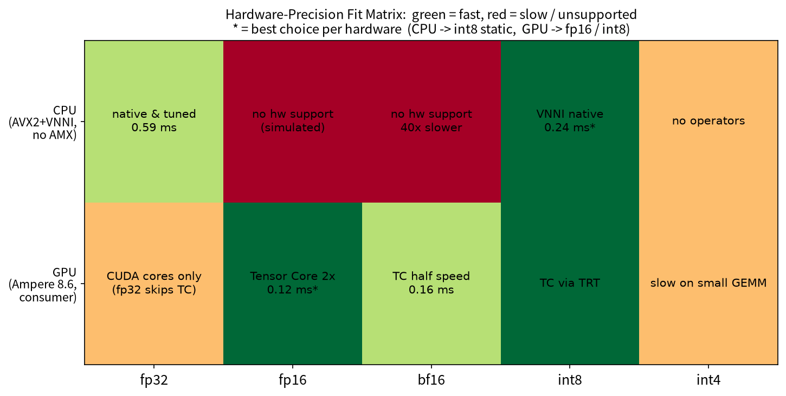

# MNIST 模型量化对比实验：把量化方法和硬件架构讲透

训练一个 MNIST CNN（fp32 基线），对它做 bf16 / int8 动态 / int8 静态 / int4 / 2:4 稀疏等全部主流压缩，在 CPU（i5-13490F）和 GPU（RTX 3060）上用 PyTorch / TensorRT / ONNX Runtime 三种引擎全面对比体积、速度、精度——并解释**每个数字背后的硬件原因**。


*图：Hardware-Precision Fit Matrix（图中文字为英文）——绿 = 快、红 = 慢/不支持；星号 = 该硬件上的最优选择。每格三行：计算单元/指令集 → 测试框架 → 耗时。*

<details>
<summary>图中术语说明</summary>

| 术语 | 说明 |
|---|---|
| AVX2 / FMA | x86 向量指令（256 位宽），一条指令 8 个 fp32 运算 |
| AVX_VNNI | int8 点积指令（`vpdpbusd`），一条指令 4 组 8-bit 乘加 |
| AMX | Intel 服务器 CPU 矩阵引擎，消费级桌面 CPU 没有 |
| oneDNN | Intel CPU 深度学习算子库（PyTorch CPU 后端）；无硬件支持时用 fp32 模拟 fp16/bf16 |
| CUDA cores | NVIDIA 通用 FP32 单元，fp32 在这里跑 |
| Tensor Core | NVIDIA 矩阵乘专用单元（fp16/bf16/int8/int4），无 fp32 模式 |
| TRT / QDQ | TensorRT 引擎；QDQ = Quantize/Dequantize 节点显式量化 |
| tinygemm | torchao 的 int8/int4 weight-only GPU kernel，按组反量化权重 |
| PyTorch eager | PyTorch 默认逐算子执行（无编译/融合） |

完整说明见 [docs/02 · 硬件架构](docs/02_hardware.md)。
</details>

## 学习路径（按顺序读，层层深入）

> 建议按 00 → 01 → 02 → 03 → 04 顺序读：00 是术语速查表（不认识的专业词随时回来查）；01 讲「量化是什么」，02 回答「为什么在不同硬件上快慢不同」，03 教「数字怎么测才可信」，04 是全部数据与踩坑的手册（可随时跳查）。每篇开头都标注了学习目标和前置知识，深水区内容集中放在各篇文末的「进一步学习」一节，初学可跳过；每篇文末有自测题检验理解。

| # | 文档 | 内容 | 适合 |
|---|---|---|---|
| 0 | [术语速查表](docs/00_glossary.md) | 全部专业词的一句话白话解释（浮点数/激活/kernel/P50…） | 随时查阅 |
| 1 | [量化入门](docs/01_quantization_basics.md) | 量化是什么、PTQ/QAT 两条路线、动态 vs 静态、混合精度、校准教训与 QAT 解法 | 所有人，从这里开始 |
| 2 | [硬件架构](docs/02_hardware.md) | CPU/GPU 怎么算神经网络、指令集、bf16 快慢差 40 倍的根源、TRT 快 30-100 倍的原因、部署前检查清单 | 第 1 篇后 |
| 3 | [如何读懂性能数据](docs/03_reading_benchmarks.md) | 延迟/吞吐/分位数、正确计时方法、本项目踩过的 4 个 bug、对比公平性 | 想自己做基准测试的人 |
| 4 | [完整实验结果](docs/04_results.md) | 核心结论速查 + 分实验数据表 + 踩坑清单汇总 + 复现命令 | 随时查阅（手册） |

图表都在 [assets/](assets/)（12 张，由 `src/make_charts.py` 生成）。核心实验还包括：校准研究（分布匹配 > 数据量）、QAT vs PTQ（QAT 反超基线 1.3%）、训练侧 bf16/fp16 对比、ResNet-18 普适性验证（weight-only 在大模型反超 4.27x）——数据与结论见 [docs/04](docs/04_results.md)。

## 一图看结论

| 场景 | 最优选择 | 实测 |
|---|---|---|
| **CPU 部署** | int8 静态量化 | 0.242 ms（fp32 的 2.4 倍速），3.2 MB |
| **GPU 部署** | TensorRT fp16 | 0.12 ms / 32 万条/秒（eager 的 90 倍），精度无损 |
| **CPU 快速集成** | int8 动态量化 | 无需校准数据，精度最稳 |
| **大模型训练** | bf16 混合精度 | 指数位与 fp32 相同，不易溢出（CPU 上无硬件支持，勿用） |

## 项目结构

```
mnist_optim/
├── README.md
├── docs/                  # 教程文档（按上面学习路径读）
│   ├── 01_quantization_basics.md
│   ├── 02_hardware.md
│   ├── 03_reading_benchmarks.md
│   └── 04_results.md
├── assets/                # 图表（8 张，教学用）
├── src/                   # 全部脚本（见下表）
├── models/                # 训练/量化产物（fp32/bf16/int8/引擎文件）
├── data/                  # MNIST（自动下载）
└── data_fmnist/           # Fashion-MNIST（自动下载）
```

### 脚本清单

| 脚本 | 作用 |
|---|---|
| `src/model.py` | CNN 定义（3×Conv-BN-ReLU + 2×FC，约 200 万参数） |
| `src/train.py` | fp32 训练（5 epoch，GPU 几分钟） |
| `src/quantize.py` | bf16 混合精度 + int8 动态量化 |
| `src/quantize_static.py` | int8 静态量化（FX 图模式 + 校准） |
| `src/build_trt.py` | ONNX 导出 + TRT 引擎构建（fp32/fp16/bf16/int8-QDQ） |
| `src/bench_trt.py` | TRT 引擎速度 + 准确率基准 |
| `src/bench_torchao.py` | torchao int8/int4 weight-only GPU 对比 |
| `src/bench_ort.py` | ONNX Runtime CPU/CUDA provider 对比 |
| `src/build_sparse.py` / `src/bench_sparse.py` | 2:4 结构化稀疏实验 |
| `src/verify_fmnist.py` | Fashion-MNIST 鲁棒性验证 |
| `src/calibration_study.py` | 校准研究（数据量×方法扫描+跨数据集对照） |
| `src/qat_study.py` | QAT vs PTQ 对比 |
| `src/train_amp_study.py` | 训练侧 bf16/fp16 autocast 对比 |
| `src/resnet18_study.py` | ResNet-18 普适性验证（大模型 vs 小模型） |
| `src/export.py` | 统一导出入口（PyTorch/ONNX/TRT 全形态） |
| `src/serve.py` | FastAPI 推理服务 Demo（/predict、/predict_batch） |
| `src/benchmark.py` | PyTorch CPU 综合基准（P50/95/99 + 批量扫描） |
| `src/inference.py` | 端到端推理 Demo（8 种模型形态） |
| `src/make_charts.py` | 生成 assets/ 全部图表 |

## 快速开始

```bash
# 环境：conda py312（Python 3.12 + torch 2.6+cu124）
pip install tensorrt onnx onnxruntime-gpu torchao==0.13.0 matplotlib

conda run -n py312 python src/train.py            # 1. 训练 fp32 基线
conda run -n py312 python src/quantize.py         # 2. 动态量化 + bf16
conda run -n py312 python src/quantize_static.py  # 3. 静态量化
conda run -n py312 python src/benchmark.py        # 4. CPU 综合基准
conda run -n py312 python src/build_trt.py        # 5. TRT 引擎构建
conda run -n py312 python src/bench_trt.py        # 6. TRT 基准
conda run -n py312 python src/verify_fmnist.py    # 7. 难任务验证
conda run -n py312 python src/inference.py --model int8_static --images 5  # 8. 试试推理
conda run -n py312 python src/calibration_study.py  # 9. 校准研究
conda run -n py312 python src/qat_study.py        # 10. QAT vs PTQ
conda run -n py312 python src/train_amp_study.py  # 11. 训练侧 bf16 对比
conda run -n py312 python src/resnet18_study.py   # 12. ResNet-18 普适性
conda run -n py312 python src/export.py --list    # 13. 查看全部产物
conda run -n py312 python src/serve.py --selftest # 14. 服务冒烟测试
```

完整复现命令见 [docs/04_results.md](docs/04_results.md)。

## 核心发现速览

1. **CPU 选 int8 静态、GPU 选 TRT fp16**——精度格式的速度由硬件是否有原生执行单元决定（[02 · 硬件架构](docs/02_hardware.md)）；
2. **校准数据的分布匹配 > 数据量 > 方法**：同分布校准 256 张就够（掉 0.2%），跨分布校准掉 5.3% 且无法用数据量弥补；QAT 微调 3 epoch 反超 fp32 基线 1.3%；
3. **TensorRT 快 30-100 倍的根源是执行方式**（无 Python 分发 + 算子融合 + kernel 调优），不是精度；
4. **bf16 是"训练格式"**：消费级 GPU 推理选 fp16（bf16 只有 fp16 一半吞吐）、CPU 上完全不要用；
5. **训练侧 bf16/fp16 无损**：bf16 快 1.4 倍、fp16 快 1.7 倍；weight-only 量化在 ResNet-18（1100 万参数）上 GPU 反超 4.27 倍，证实其适合大模型；
6. **TRT 11 移除了旧 int8 校准 API**，int8 走 QDQ 显式量化；onnxruntime-gpu 分 CUDA 12/13 二进制，TRT-EP 只兼容 TRT 10。
