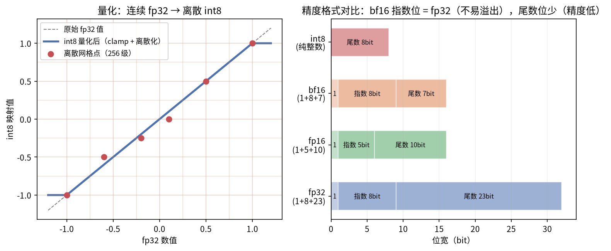
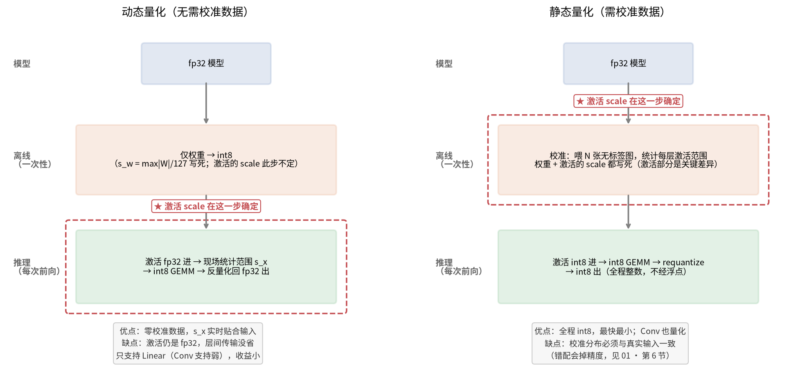
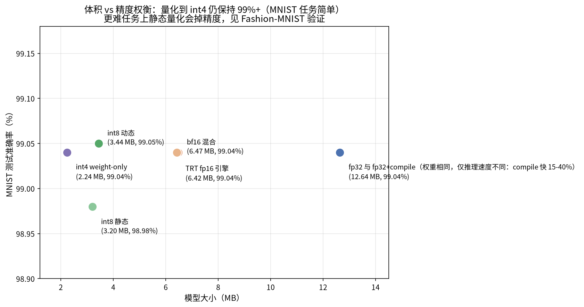

# 01 · 量化入门：从 fp32 到 int8，模型为什么能变小变快

> **学习目标**：理解量化是什么、为什么能换体积和速度、整数量化的动态/静态之分、什么时候会掉精度以及怎么救。
> **前置知识**：无，从这里开始。
> **本篇不覆盖**：同一精度在不同硬件上为什么快慢差 40 倍（[02 · 硬件架构](./02_hardware.md)）；性能数据怎么测才可信（[03 · 如何读懂性能数据](./03_reading_benchmarks.md)）。
>
> 所有结论都来自本项目的真实实验（MNIST CNN，200 万参数），复现命令见文末。深水区内容集中在文末「**进一步学习**」一节，初学可跳过，不影响主线。

## 1. 什么是量化

神经网络训练时权重是 **fp32**（32 位浮点数）。**[浮点数](./00_glossary.md)**（fp = floating point）就是二进制版的科学计数法：把一个数拆成「正负号 + 指数 + 尾数」三段来存——指数管数量级、尾数管有效数字（隐含首位等细节见术语表）。下面 fp32/fp16/bf16 的全部区别，就是这三段怎么分配。

**量化（广义）= 把 fp32 换成位数更少的格式存和算**，含两条技术路线：

- **整数路线（int8/int4）**：映射到等距整数格点，需要 **[scale](./00_glossary.md)** 换算——工业界狭义的"量化"常专指这条；
- **浮点路线（fp16/bf16）**：重排位域、保留浮点语义，不需要 scale（TensorRT 亦称其为 FP16/BF16 quantization）。

两条路线的机制差异是 §1 的主线。

- **fp32**：1 位符号 + 8 位指数 + 23 位尾数。指数位多 → 数值范围大（约 10^±38）；尾数位多 → 精度高。
- **fp16**：指数 5 位、尾数 10 位。范围小（约 ±65504），大数值会溢出。
- **bf16**：**指数位与 fp32 相同（8 位）**、尾数 7 位。范围和 fp32 一样大（训练时不易溢出），但精度低——这就是大模型训练偏爱 bf16 的原因。
- **int8**：纯整数 256 级（-128~127）。需要一个 **[scale](./00_glossary.md)（缩放系数）** 把浮点范围映射进来（对称量化实际只用 255 级，256 vs 255 的区别见文末「进一步学习」）。
- **int4**：纯整数 16 级。分辨率太粗，直接量化会把大量小权重抹成 0——解决办法 per-group（分组各配 scale）见文末「进一步学习」。

**整数量化（int8/int4）一个值的标准公式是三步：除以 scale → 四舍五入 → clip 到整数范围**（`q = min(qmax, max(qmin, round(x / s)))`）。前两步大家都能想到，第三步 clip 是必须的保险——不裁剪的话超出范围的值会溢出整数边界变成无关值。**所有静态量化的精度问题都出在这个公式对 s 的依赖上**，下面展开。



上图就是这三步的完整流程：面板①②③依次演示样本值如何被拉伸、取整、截断，面板④是各格式的位域划分。要记住：`q = clip(round(x / s))` 这个「除 scale → 取整 → clip」的公式**只适用于整数路线**——fp16/bf16 是浮点路线，不需要 scale，走的是位域重排。两条路线的七维机制对比（公式/scale/误差/溢出等）集中在 [§5.2 的对比表](#52-它消灭什么不消灭什么精确的边界)，读到 §5 时对照着看更清楚——§1 先把整数路线讲完。

**量化的本质是牺牲精度换体积和速度**：一个 fp32 数字占 4 字节，int8 只占 1 字节——理论上模型直接缩到 1/4。

## 2. 两条路线：PTQ 与 QAT

量化方法先按**"要不要重新训练"**分成两条路线，这是所有量化算法的第一层分类：

| 维度 | PTQ（训练后量化，Post-Training Quantization） | QAT（量化感知训练，Quantization-Aware Training） |
|---|---|---|
| 核心思想 | 模型已练完、权重不再动。**int 路线**：拿少量无标签数据**喂一遍模型，统计每层[激活](./00_glossary.md)的数值范围**，据此算出 scale 写死进模型（**只有 int 量化才需要算 scale**）；**fp16/bf16 路线**：直接转换位域格式，没有 scale 这一步 | 允许再训练：训练时每层前向先「假装量化」（[fake-quant](./00_glossary.md)，见[第 7 节](./01_quantization_basics.md#7-qat静态量化掉精度的标准解法)），让权重在梯度更新中**主动适应取整误差**（只服务 int 路线；fp16/bf16 转换无需 QAT） |
| 需要什么 | **静态量化**需少量[校准](./00_glossary.md)数据（几百~几千张，不用标签）；**动态量化零数据**（激活范围推理时现场统计）；fp16/bf16 转换直接 cast，什么都不需要 | 完整训练集 + 标签 + 训练资源（微调几个 [epoch](./00_glossary.md)） |
| 成本 | 分钟级、零训练 | 本项目 3 epoch / 29 秒；大模型则数小时~数天 |
| 量化参数怎么定 | int 路线：统计校准数据的分布定 scale（min/max/分位数）；fp16/bf16：无需参数 | int 路线：训练中自动学出 scale（observer 同步收集）；fp16/bf16：无需参数 |
| 为什么 QAT 通常更准 | 参数靠「猜」：统计校准分布，猜得准不准取决于**分布匹配度** | 不猜：让梯度下降带着权重去适应写死的量化公式，模型自己找到对量化最鲁棒的解 |
| 精度 | 任务简单/分布匹配时无损；分布错配可能掉精度（第 6 节就是分布错配的真实事故） | 通常**优于** PTQ，甚至反超 fp32 基线（量化噪声当正则化） |
| 适用 | 快速部署、任务简单、拿不到训练管线 | PTQ 掉精度、精度敏感、训练管线可用 |

一句话类比：PTQ 是「成衣直接上身，不合适就认了」；QAT 是「边穿边改，改到合身」——前者快而省，后者准而贵。所以工程实践是先用 PTQ（便宜），实测掉精度再上 QAT（本项目 Fashion-MNIST：PTQ 87.45% → QAT 93.95%，详见第 7 节）。

第 3 节讲的动态/静态量化属于 **int 路线内部（PTQ）的两个子类**——浮点路线没有这个区分（没有 scale 可言）；接下来看它们的区别。

## 3. 整数量化再分类：动态 vs 静态（本项目的核心实验）

动态/静态的区分**只存在于整数路线**——浮点路线（fp16/bf16）没有 scale，不存在"scale 现算还是写死"的问题。两者都是 PTQ，权重都在部署时提前量化为 int8；唯一的分水岭是**给激活配的 scale 是「用到时现算」（动态），还是「校准时量好、写死在模型里」（静态）**（scale = 浮点与整数之间的汇率，是量化附带的参数、随权重一起存进模型——不是激活本身）：



**一句话总结**：两者权重都部署时量化为 int8；动态量化的激活在每层输入时**现场算 scale 量化**、输出后**反量化回 fp32**（层间是浮点，每层一个"量化-反量化"来回）；静态量化的激活用写死的 scale 直接量化，输出 int32 经 **requantize** 变回 int8 传给下一层——层间全程 int8，但注意仍有轻量 requantize（int32→int8 不碰浮点、不算 scale），并非"零量化"（requantize 公式的推导、s_next 与 s_x 的区别，见文末「进一步学习」）。下面用一个能逐行读懂的例子展开。

### 3.1 例子：同一层 fc1 在两种量化下如何执行

设某一层 fc1 要算 `y = W·x`（W 是权重矩阵，x 是输入激活）。**"量化"指的是把浮点数变成 `int8 = clip(round(fp32 / scale))`（clip 的作用见文末「进一步学习·⑦」），scale 记录在旁边，算完再乘回去还原**。

**动态量化跑这层时**（权重提前量化，激活现场量化）：

```
部署时（离线，一次性）：
  W_fp32  ──→  W_int8 = clip(round(W / s_w))，s_w = max|W| / 127   ← 写进模型

推理时（每次前向，逐层重复）：
  ① x_fp32 进来
  ② 现场统计范围：s_x = max|x| / 127          ← 这一步就是"动态"
  ③ x_int8 = clip(round(x / s_x))             ← 量化激活
  ④ int8 GEMM：y_int32 = W_int8 × x_int8      ← 整数乘加，快
  ⑤ 还原：y_fp32 = y_int32 × s_w × s_x        ← 反量化回浮点
  ⑥ y_fp32 传给下一层                          ← 下一层又要从 ① 重新来
```

⑤ 之所以叫**反量化**：由量化定义 `W_int8 ≈ W_fp32 / s_w`、`x_int8 ≈ x_fp32 / s_x`，两式相乘正好得到 `y_int32 ≈ y_fp32 / (s_w × s_x)`——量化时除以 scale 把真值缩小装进整数域，反量化乘回 scale 还原，**一除一乘互为逆操作**（round 带来的 ±s/2 误差是唯一损耗，完整推导见文末进一步学习）。

**静态量化跑这层时**（权重与激活的 scale 都在部署期算好，写死）：

```
部署时（离线，一次性）：
  W_fp32 ──→ W_int8 = clip(round(W / s_w))，s_w = max|W| / 127    ← 与动态量化相同

校准时（离线，喂 1024 张图）：
  对每层激活观察统计 max|x| → s_x              ← 与动态的 ② 相同公式，但只算这一次

推理时（每次前向）：
  ① x_int8 进来（上一层输出已是 int8，直接用）
  ② int8 GEMM：y_int32 = W_int8 × x_int8      ← 同样的整数乘加
  ③ requantize：y_int8 = clip(round(y_int32 × s_w × s_x / s_next))
                          ↑ 公式怎么来的、s_next 为何与 s_x 不同，见文末「进一步学习」
  ④ y_int8 传给下一层
```

### 3.2 差异与优缺点总览

| 差异点 | 动态量化 | 静态量化 |
|---|---|---|
| s_x（激活 scale）哪来 | **每次前向现场算**（max 统计 + 除法 + round，全是开销） | 校准时算好，推理时查表 |
| 层间传递的数据 | fp32（算完就反量化回去了） | int8（requantize 直达下一层） |
| 可量化层 | Linear（Conv 的激活动态量化 kernel 不成熟，通常保持 fp32） | Conv + Linear（全图） |
| 数值精度 | s_x 反映当前批次的真实范围，最准；且 **s_x = max\|x\|/127 恒成立，最大值必落在 127 边界内，机制上不可能触发 clip 截断**（代价：离群值会撑大 s_x，让其余值的步长变粗） | s_x 是校准集的统计近似，分布偏了就掉精度（四层防御见 [§6](#6-真实教训校准数据的分布必须与真实输入一致)） |
| **优点** | 零校准数据、即拿即用 | 最快最小；Conv 也量化；kernel 融合（= 多个算子合并成一个计算函数连续执行，省去中间结果读写——GPU 上是合成一个 CUDA 函数、CPU 上是合成一个指令集例程，详见 [02 · GPU 上发生了什么](./02_hardware.md#3-gpu-上发生了什么)与 [00_glossary](./00_glossary.md)） |
| **缺点** | 每层每次付统计/转换开销；层间 fp32 传输 | 需代表性校准集；分布偏移时 scale 失准 |
| **适合** | 快速集成、[Linear](./00_glossary.md) 为主的模型（为什么 BERT 类是 Linear 为主，见下方说明） | 卷积模型、追求极限速度/体积的生产部署 |

**为什么 BERT 类是"Linear 为主"**：BERT = N 层 Transformer 编码器堆叠，每个块由 Multi-Head Self-Attention（Q/K/V 三个 Linear 投影 + 输出 Linear）和 FFN（两个 Linear）组成——**没有卷积，参数和计算量 100% 由 Linear 承担**（GPT/LLaMA/ViT 等 Transformer 系同理）。这与 CNN 相反：MnistCNN 的计算大头是 Conv。所以动态量化（只量化 Linear）能覆盖 Transformer 的计算主体，对 CNN 则覆盖不足。

**但注意**：动态量化对 BERT 的价值是**零校准、快速验证**——它是"量化后精度掉多少"的第一步实验。生产上 BERT 类模型更常用静态量化（层间 int8 的全部收益）或 QAT/weight-only：BERT 激活范围随输入序列波动大，写死 scale 的收益/风险权衡需要按第 6 节实测。

### 3.3 实测与代价

本项目实测（CPU，i5-13490F）：

| 模型 | 大小 | [P50](./00_glossary.md) 延迟\* | 准确率（MNIST） |
|---|---|---|---|
| fp32 | 12.64 MB | 0.592 ms | 99.04% |
| int8 动态 | 3.44 MB | 0.563 ms | 99.05% |
| **int8 静态** | **3.20 MB** | **0.242 ms** | 98.98% |

差距来源：动态量化每个 Linear 层每批数据都要做 ②③⑤ 三次转换，且层间 fp32 传输、Conv 保持浮点；静态量化把这些全部在离线付清，推理时是纯 int8 链路，所以快 2.3 倍。

**代价**：s_x 写死意味着如果真实输入的范围超出校准时的统计，量化值会饱和截断、精度受损（机制见文末进一步学习「clip 到底做了什么」）。

\* 表中延迟取的是 [P50](./00_glossary.md)（中位数）而非平均值——为什么看分位数，见 [03 · 为什么要看分位数](./03_reading_benchmarks.md#2-为什么要看分位数)。

## 4. Q1：量化会掉精度吗——各模型的精度/体积实测

§3.3 的"代价"听着吓人，实际上 MNIST 任务简单（99% 基线意味着模型"余量"很大），int8 的 255 级分辨率（对称量化，见文末「进一步学习」）足够表达每层权重的相对大小——量化引入的扰动被模型的冗余吸收了。实验中量化到 **int4（16 级）**精度仍然无损（99.04%），GPU 上 TRT fp16 引擎（6.42 MB）精度也无损：



但这**不能推广到所有任务**——大模型的权重分布长尾更严重，对量化敏感得多。判断依据永远是：在你的任务上实测。

另外，"哪种量化手段适合我的模型"还与**架构**有关（Transformer 全是 Linear、CNN 以 Conv 为主，直接决定动态量化能否覆盖），对应表格见 §8 的选择指南。

## 5. Q2：量化的另一种形式——浮点量化（fp16/bf16）

Q1 的答案是"几乎不掉"，但如果你的任务复杂到 int8 真的掉精度呢？或者根本不想操心校准？——还有一条**零校准、无饱和截断风险**的路线：浮点量化（fp16/bf16）。它把 32 位压到 16 位而非 8 位（体积只减半而非 3/4），完全绕开 scale 和校准，工程上往往是第一试用方案（§8 选择指南里两行推荐依赖本节）。

### 5.1 是什么：不用 scale 的压缩

浮点量化属于**广义量化的浮点路线**（§1 已定义两条路线）——同样把 32 位压到 16 位，但不走整数格点（不引入 scale），而是直接把 IEEE 754 位域重排成更短的浮点格式（「换一套位域」，与整数路线的完整差异见 5.2 对比表）。

### 5.2 它消灭什么、不消灭什么：两条路线的完整对比

初学者最关心的是"它到底准不准"。浮点转换**不是没有误差**，它与 int 路线的全部机制差异一张表看全（§1 埋的钩子在这里兑现）：

| 维度 | 整数路线（int8/int4） | 浮点路线（fp16/bf16） |
|---|---|---|
| 公式 | `clip(round(x / s))` 三步 | IEEE 754 位域重排(fp16)或直接截断(bf16)（转换成本见文末「进一步学习·①」） |
| 需要 scale | **是**（整个方法的核心） | 否 |
| 误差来源 | round 到整数格 + 越界 clip | 尾数位变少（有效数字变少，相对误差变大）**+ 指数位变少**（数值范围缩水，fp16 会溢出；bf16 指数位不变、范围不缩水） |
| 误差形态 | **绝对误差**：±s/2，与数值大小无关 | **相对误差**：bf16 ~2^-8、fp16 ~2^-11，与数值成正比（见文末「进一步学习·②」） |
| 饱和截断 | **有风险**：写死的 scale 撑不住真实范围时，大片值集体压平（§6 事故） | **无此模式**（指数位自适应任何量级，不存在"超出 scale 表示范围"）；但有上溢风险——超过格式最大值（fp16 为 ±65504）直接变 inf，见下行 |
| 溢出行为 | clip 截断（压到边界，还能用） | fp16 大值**上溢成 inf**（训练要配 GradScaler，见文末「进一步学习·②」）；bf16 范围与 fp32 相同、天然免疫 |
| 尾数位变化 | ——（整数没有尾数） | fp16 丢 13 位（23→10）、bf16 丢 16 位（23→7） |
| 直觉 | 挪范围进格子（scale 是灵魂） | 换一套位域（指数保范围、尾数定精度） |

一句话：浮点路线消灭的是 §6 那种**饱和压平的事故模式**（"零校准、无饱和截断风险"的确切含义），不是误差本身——舍入误差依然存在，只是形态从"绝对误差"换成了"相对误差"。

### 5.3 概念澄清：浮点量化 ≠ 一定是混合精度

把模型所有层统一转成 fp16/bf16（纯 fp16 模型），就是浮点量化但**不是**混合——"混合"另有定义（见 5.4）。两者关系：浮点量化说的是**用什么格式**（16 位浮点位域），混合精度说的是**怎么用**（层间/张量间精度不均匀）。本项目的 `make_bf16_mixed` 恰好两者都占（浮点路线 + 层间混用），所以名字容易被当成一类东西。

### 5.4 为什么叫"混合精度"：名字强调用法

模型里不同层用不同精度（本项目 bf16 混合 = 大部分层 bf16 + 敏感层 fp32），而非单一格式一压到底——它是浮点量化的一种**用法**，不是浮点量化的同义词。这个名字源于训练场景（NVIDIA 2017 年的 Mixed-Precision Training）：前向/反向的计算用 fp16 提速，但**需要梯度更新的可训练权重**要保留一份 fp32 主副本——否则 `w += lr × grad` 的小梯度会在 16 位上被舍入吃掉（fp16 尾数 10 位，w=3.0 时相邻数的间隔约 0.002，1e-4 的更新直接消失），几百步累积下来训练不收敛。注意"必须"的边界：冻结的层（不接收更新）、BN 统计量（autocast 白名单本就保持 fp32）、推理场景的所有权重，都不需要主副本。"fp32 主副本 + fp16 计算"混着用，就是"混合"二字的出处；推理场景把它引申为"层间精度不均匀"。

### 5.5 浮点路线的两种策略：bf16 混合精度 vs weight-only

| 维度 | bf16 混合精度（`make_bf16_mixed`） | weight-only 量化（`bench_torchao.py`） |
|---|---|---|
| 做法 | 大部分层权重转 bf16（浮点路线），**敏感层保留 fp32** | 权重存 int8/int4（整数路线），激活保持 bf16 |
| 敏感层/未量化层 | 首层 conv（接触原始像素）、全部 [BatchNorm](./00_glossary.md)（统计量敏感）、最终分类层（[logits](./00_glossary.md) 差一点就分错类） | 所有 Conv/Linear 权重都量化，激活不量化 |
| 体积 | 12.64 → 6.47 MB（约一半） | 12.64 → 3.45 MB（int8wo）/ 2.24 MB（int4wo） |
| 精度 | 无损（99.04% → 99.04%） | 无损（int8wo/int4wo 均 99.04%） |
| 速度（本实验小模型） | GPU ×2（[Tensor Core](./00_glossary.md)）；CPU 慢 40 倍（无硬件支持） | GPU 持平 fp32（小模型上反量化开销抵消收益）；ResNet-18 上反超 4.27× |
| 适合 | GPU 训练与推理、大模型（不溢出） | 显存敏感的大模型推理；小模型收益有限 |

## 6. Q3：int 路线的真正风险——校准数据的分布必须与真实输入一致

混合精度绕开了校准；但如果走 int 路线（体积减 3/4 的诱惑），校准就是绕不开的功课，而且它的坑比想象中深。在更难的 Fashion-MNIST（fp32 基线 92.68%）上重复了全部量化流程（`verify_fmnist.py`）：

| 模型 | 准确率 | 损失 |
|---|---|---|
| bf16 混合 | 92.68% | 0.00% |
| int8 动态 | 92.66% | -0.02% |
| **int8 静态** | **87.45%** | **-5.23%** ⚠️ |

bf16/动态量化的"无损"是普遍规律。静态量化掉的 5 个点，最初以为是校准数据不足——但校准研究（`calibration_study.py`）推翻了这个直觉：

| 校准场景 | 掉精度 | 加大数据量能否救回 |
|---|---|---|
| 同数据集，256 张 vs 16384 张 | 都只 ~0.2%，MinMax/Histogram 差异 <0.1% | 不需要（256 张就够） |
| 跨数据集（本事故：用 MNIST 数据校准 Fashion-MNIST 模型，归一化参数不同） | **5.3%**，且 16384 张错分布数据仍 5.6% | **救不回**（错分布的数据越多越确认错误） |

**生产准则：校准数据的分布与真实输入一致（同样预处理/归一化），比数据量和校准方法重要得多。** 静态量化写死 scale 的四层防御：

| 防御层 | 做法 | 原理 |
|---|---|---|
| ① 分布匹配（最重要） | 校准数据与真实输入同数据集、**同预处理/归一化** | scale 是统计量，分布对了统计才准 |
| ② 分位数截断 | Histogram/Percentile observer 用 99.9% 分位代替 max | 主动 clip 0.1% 长尾，换其余 99.9% 值的更细分辨率（截断本身也是手段，见文末「进一步学习·⑧」） |
| ③ per-channel 粒度 | 权重按输出通道各配一个 scale | 不同卷积核范围差几倍，一个 scale 顾此失彼 |
| ④ QAT | 训练时插 fake-quant，权重适应量化约束 | 让模型把重要信息搬离量化边界（下一节） |

校准掉精度的标准解法是 QAT（下一节）；完整的校准研究数据（数据量 × 方法扫描表）见 [04 · 校准研究](./04_results.md#27-校准研究数据量--方法扫描)。

## 7. Q3 的终极解法：QAT（校准四层防御也不够时）

QAT（量化感知训练）：把 [fake-quant](./00_glossary.md) 节点插进模型，**边训练边让权重适应量化约束**。本项目在掉 5.23% 的同一 Fashion-MNIST 任务上，QAT 仅微调 3 epoch / 29 秒：**87.45% → 93.95%**——不仅恢复 6.5 个百分点，还**反超 fp32 基线 1.3%**（fake-quant 的量化噪声起到了正则化作用：训练时持续扰动权重，逼模型学更鲁棒的表征，细节见文末「进一步学习·两种路线的误差长什么样」）。成本极低，是静态量化掉精度时的首选解法（完整三方对比表见 [04 · QAT vs PTQ](./04_results.md#28-qat-vs-ptq量化感知训练)）。

## 8. Q4：怎么选——场景与架构速查

| 场景 | 推荐 | 理由 |
|---|---|---|
| CPU 部署 | **int8 静态量化** | 最快（2.4×）最小（3.2MB），注意校准集质量 |
| CPU 快速集成 | int8 动态量化 | 无需校准数据，精度最稳 |
| GPU（消费卡） | **TensorRT fp16** | 零精度损失、吞吐最高（32 万条/秒）；为什么引擎能快这么多见 [02 · GPU 上发生了什么](./02_hardware.md#3-gpu-上发生了什么) |
| GPU 体积敏感 | TensorRT int8 | 3.3 MB，需校准集 |
| 静态量化掉精度 | **QAT 量化感知训练** | 本实验恢复 6.5% 且反超基线，成本极低 |
| 大模型训练 | bf16 混合精度（浮点路线，见 §5） | 指数位与 fp32 相同，不易溢出 |
| 大模型显存敏感 | torchao weight-only | int8/int4 权重 + bf16 激活 |

**按架构维度看**（呼应 §3 的动态/静态选择——Transformer 全是 [Linear](./00_glossary.md)、CNN 以 [Conv](./00_glossary.md) 为主，直接决定 int 路线中动态量化能否覆盖计算主体）：

| 架构 | 计算主体 | 动态量化覆盖度 | 生产上常见选择 |
|---|---|---|---|
| Transformer（BERT/GPT/LLaMA/ViT） | 全部 Linear | **高**（覆盖计算主体） | 静态量化 / QAT / weight-only |
| CNN（ResNet/MnistCNN） | Conv 为主 | 低（Conv 覆盖不了） | 静态量化（Conv 必须 int8）或 weight-only |

**选好量化方式之后还有一层**：同样的模型，PyTorch eager GPU 吞吐 1.8k 条/秒，TensorRT 引擎 10 万+ 条/秒——这是**执行方式**的增益（无 Python 分发、算子融合、kernel 自动调优），已超出量化教程的范围，原理展开见 [02 · GPU 上发生了什么](./02_hardware.md#3-gpu-上发生了什么)，完整数据见 [04 · TRT 部署对比](./04_results.md#22-tensorrt-部署对比fp32--fp16--bf16--int8-引擎)。注意 PyTorch 的 `quantize_dynamic` 只有 CPU 实现（依赖 [oneDNN/FBGEMM](./00_glossary.md)），int8 上 GPU 必须走 TensorRT（[QDQ](./00_glossary.md) 显式量化）或 torchao。

| 场景 | 推荐 | 理由 |
|---|---|---|
| CPU 部署 | **int8 静态量化** | 最快（2.4×）最小（3.2MB），注意校准集质量 |
| CPU 快速集成 | int8 动态量化 | 无需校准数据，精度最稳 |
| GPU（消费卡） | **TensorRT fp16** | 零精度损失、吞吐最高（32 万条/秒）；为什么引擎能快这么多见 [02 · GPU 上发生了什么](./02_hardware.md#3-gpu-上发生了什么) |
| GPU 体积敏感 | TensorRT int8 | 3.3 MB，需校准集 |
| 静态量化掉精度 | **QAT 量化感知训练** | 本实验恢复 6.5% 且反超基线，成本极低 |
| 大模型训练 | bf16 混合精度（浮点路线，见 §5） | 指数位与 fp32 相同，不易溢出 |
| 大模型显存敏感 | torchao weight-only | int8/int4 权重 + bf16 激活 |

**按架构维度看**（呼应 §3 的动态/静态选择）：

| 架构 | 计算主体 | 动态量化覆盖度 | 生产上常见选择 |
|---|---|---|---|
| Transformer（BERT/GPT/LLaMA/ViT） | 全部 [Linear](./00_glossary.md) | **高**（覆盖计算主体） | 静态量化 / QAT / weight-only |
| CNN（ResNet/MnistCNN） | [Conv](./00_glossary.md) 为主 | 低（Conv 覆盖不了） | 静态量化（Conv 必须 int8）或 weight-only |

## 进一步学习

以下小节是给想刨根问底的读者的深水区内容，初学可跳过，不影响主线（各小节开头标注了主线对应位置）：

1. fp16/bf16 转换的硬件成本（主线 §1）
2. 两种路线的误差长什么样，为什么 fp16 训练要 GradScaler（主线 §1/§2）
3. 反量化为什么是"乘回去"（主线 §3.1）
4. requantize 公式怎么来的，s_next 和 s_x 为什么不同（主线 §3.1）
5. 为什么对称量化只有 255 级（主线 §1）
6. int4 为什么必须 per-group 配 scale（主线 §1）
7. clip 到底做了什么（主线 §1/§3.3）
8. scale 失准的免疫力、防御与"scale 的最优选择"——含"故意取小触发 clip 更好"的权衡（主线 §6）
9. 预处理（标准化）为什么对量化致命（主线 §6）
10. "大模型权重分布长尾更严重"是什么意思（主线 §4）

### ① fp16/bf16 转换的硬件成本（主线对应：§1）

fp16 的位域重排（指数 8→5、尾数 23→10）有专用转换指令——x86 F16C 的 `VCVTPS2PH`（2012 年起）、ARM `FCVT`、GPU `cvt`，真·一条指令；bf16 因为就是 fp32 的前 16 位，GPU 上一条 `cvt` 或直接截断即可，**不支持 AVX512-BF16 的 CPU（如本机 i5-13490F）则退化为「把 fp32 当整数右移 16 位」的截断**——是普通整数运算而非转换指令。实战中权重通常在离线阶段就 cast 好写进模型，运行时几乎不付这个转换成本。

### ② 两种路线的误差长什么样，为什么 fp16 训练要 GradScaler（主线对应：§1/§2）

**误差形态**：int8 量化的误差是**绝对误差**——不管原值是 0.1 还是 100，误差都不超过半个 scale（±s/2，均匀分布），越界值被 clip 塌缩到边界（有界）；fp16/bf16 的误差是**相对误差**——尾数位数固定，数越大、绝对误差越大，但始终和数值成比例（fp16 约 2^-11、bf16 约 2^-8）。前者保证小值也准，后者保证大值不失真，两种保证不可兼得——这正是「需要 scale 的整数量化」和「不需要 scale 的位域重排」的本质差异。

展开看「±s/2 从哪来」。误差的唯一来源是三步里的**四舍五入**：除以 scale 得到的缩放值落在两个整数格之间，round 取最近的格，残差最多偏 0.5 个格，乘回 s 就是误差 ≤ ±s/2。以第 3 节算例的 s = 0.011024 为例：

```
x = 0.37 → x/s = 33.57 → round 到 34 → 还原 34 × 0.011024 = 0.375
误差 = 0.37 − 0.375 = −0.005 ≈ 0.43 个格 × s   （≤ s/2 = 0.0055）
```

误差大小只取决于**离最近整数格差多少格**，与数值本身多大无关——这就是「绝对」误差的含义。假设另一层的 s = 0.85（量程 ±108，装得下 100）：

```
x = 0.1  → x/s =   0.12 → round 到   0 → 误差 = 0.12 格 × 0.85 ≈ 0.10
x = 100  → x/s = 117.65 → round 到 118 → 误差 = 0.35 格 × 0.85 ≈ 0.30
```

两次误差都 ≤ s/2 = 0.425：原值放大 1000 倍，误差上限不变（前提是不越界触发 clip）。对比 fp16 的相对误差就看出差别：值是 100 时，fp16 的绝对误差按比例放大到约 100×2^-11 ≈ 0.05；值是 0.1 时只有 0.00005——int8 的误差上限与数值大小**无关**（恒为 s/2），fp16 的误差上限与数值**成正比**。

「均匀分布」说的是**误差的分布**，不是缩放后的值落在 [−s/2, s/2]（常见误解）。当一批数据覆盖很多格点时，每个值的舍入残差落在 [−0.5, 0.5] 个格里各处的机会差不多，所以误差近似均匀铺在 [−s/2, s/2] 上——平均误差约 s/4，最坏 s/2。

**GradScaler**：fp16 的指数位只有 5 位，大值会**上溢成 inf**。训练时梯度更新量常小于 fp16 能表示的最小数（下溢变 0），所以必须用 GradScaler 把 loss 先放大一个系数、反量化后再缩回；bf16 指数位与 fp32 相同、范围一样大，上下溢风险都小，不需要 GradScaler——这就是训练侧偏爱 bf16 的根源（与 §1 对比表的「溢出行为」行对应）。

**为什么会"上溢成 inf"**——这是 IEEE 754 的编码机制，不是偶然现象。fp16 的 5 位指数能产生 0~31 共 32 个编码，协议规定：编码 0 表示零和次正规数（极小值），编码 1~30 是正常数（范围 2^-14 ~ 2^15），**编码 31（全一）被保留为特殊标记**——尾数为 0 表示 ±inf，尾数非 0 表示 NaN。所以 fp16 的正常数最大只能到 `(2 - 2^-10) × 2^15 = 65504`：这不是人为划的边界，而是"5 位指数能编码的最大数"的数学结果。运算结果一旦超过它，硬件只能返回编码 31（inf）。

inf 与 int8 的 clip 是两种本质不同的"装不下"：

| | int8 量化 | fp16 浮点 |
|---|---|---|
| 装不下的原因 | 8 位整数只有 256 个格子，scale 定了范围就锁死 | 5 位指数能编码的数值范围有限 |
| 装不下时硬件做什么 | **clip**：压到最近边界 127——结果"错误但可用" | **溢出**：返回 inf——结果是个失败标记，不是数 |
| 后续传播 | 误差有界（最多丢"超出的那一段"） | inf **污染后续运算**（inf × 0 = NaN，一个 inf 传染整层） |
| 是否可恢复 | 有界误差，模型可能容忍 | 不可恢复，必须防（GradScaler / 换 bf16） |

关键差别：**clip 是"数值域内的最近似表示"，inf 是"数值域之外的失败标记"**。bf16 之所以免疫：它的指数位 8 位与 fp32 相同，任何 fp32 装得下的数 bf16 都装得下，转换本身不产生新溢出——**bf16 用精度换范围，fp16 用范围换精度**，这就是训练选 bf16、推理常选 fp16 的根本原因。

### ③ 反量化为什么是"乘回去"（主线对应：§3.1）

由量化定义，权重和激活都是"真值除以 scale 再取整"（round 引入的误差先忽略）：

```
W_int8 ≈ W_fp32 / s_w
x_int8 ≈ x_fp32 / s_x
```

两式相乘（正是第 ④ 步做的整数 GEMM）：

```
y_int32 = W_int8 × x_int8 ≈ (W_fp32 / s_w) × (x_fp32 / s_x) = y_fp32 / (s_w × s_x)
```

也就是说 **y_int32 是"真值 y_fp32 除以 (s_w × s_x) 之后的商"**——量化时除法把真值缩小了 (s_w × s_x) 倍装进整数域，还原自然是把这个倍数乘回来：`y_fp32 = y_int32 × s_w × s_x`。除以 scale 量化、乘以 scale 还原，一除一乘互为逆操作。round 带来的偏差正是量化误差的来源——每个数最多偏 ±s/2，这就是 [02 · 乘法与加法的精度行为差异](./02_hardware.md#乘法与加法的精度行为差异)里"int8 乘加精确、误差全在量化映射"的含义。

### ④ requantize 公式怎么来的，s_next 和 s_x 为什么不同（主线对应：§3.1）

requantize 的推导和反量化完全同源。已知 `y_int32 ≈ y_fp32 / (s_w × s_x)`，把它**除回去**就还原出浮点真值：

```
y_fp32 = y_int32 × s_w × s_x        ← 这就是动态量化的 ⑤（反量化）
```

但静态量化到此**不停步**——下一层的输入要的是 int8，而这个 int8 是按下一层的 scale `s_next` 定义的：`x_next_int8 = clip(round(x_next_fp32 / s_next))`。把 `y_fp32` 代进下一层的量化公式：

```
y_int8 = clip(round(y_fp32 / s_next))
       = clip(round(y_int32 × s_w × s_x / s_next))   ← 把 y_fp32 用上一行替换
       = clip(round(y_int32 × (s_w × s_x / s_next)))
```

**三行就是 ③ 的全部来源**：把"反量化 + 下一层再量化"两步合并成一次乘法。四个 scale 全在部署期写死，所以系数 `(s_w × s_x / s_next)` 是一个**常量**，部署时直接算好存进模型，推理时只做一次乘法和取整。两个细节：

- **clip 不能省**：结果可能超出下一层的 [-127, 127]，越界要压回边界（机制见下文 ⑦）；
- **为什么这一步"便宜"**：对比动态量化的 ⑤+下一层的②——反量化乘两次 scale 出浮点、现场统计 max、再除再 round，一共四五个运算且经过浮点；requantize 只有一次乘法 + 一次 round + clip，全程整数域，还能直接融合进 GEMM kernel（"int8 GEMM → requantize → ReLU 一个 kernel"）。

**追问：s_next 是什么？和 s_x 一样吗**——不一样，且这正是 requantize 的关键。两者是**相邻两层各自的激活 scale**：

```
本层 fc1 输入 x 的范围：max|x| = 1.40  →  s_x    = 1.40/127   = 0.011024
本层 fc1 输出 y 的范围：max|y| = 0.42  →  s_next = 0.42/127   = 0.003307
```

`s_x` 是本层**入口**的刻度（决定 x 怎么变成 int8 进 GEMM），`s_next` 是本层**出口**（= 下一层入口）的刻度。两层之间隔着权重变换（放大/缩小信号）和 ReLU（砍掉负半轴），输出范围和输入范围没有任何理由相等。在 requantize 公式里两者分别出现在**分子和分母**——因为它是"用入口刻度定价的 int32，换算成用出口刻度定价的 int8"的刻度换算，就像经过两个汇率的换汇。若偷懒直接用 s_x 量化输出，下一层按 s_next 反量化时会系统性偏差 `s_next/s_x` 倍，逐层累积后信号幅度完全失真。这也是静态量化要**逐层**校准的原因：N 层模型有 N+1 个激活 scale（含网络输入）+ N 个权重 scale，每个"量化域边界"都要用自己的刻度。

### ⑤ 为什么对称量化只有 255 级，不是 256

int8 有 256 个位模式（-128~127），但本项目用到的对称量化把 scale 定为 `s = max|x| / 127`，映射区间是 **[-127, +127]，共 255 个格**（原理图 ① 面板画的正是这 255 个格）。

-128 这一格是被主动牺牲的，换来两件事：

1. **正负对称**：`q(−x) = −q(x)`，0 值精确映射到 0。若用满 -128~127（除以 128），正方向 127 格、负方向 128 格，天平歪一格——requantize 和硬件 kernel 都要额外处理这个不对称；
2. **乘加范围整齐**：±127 的乘积最大 ±16129，而 (-128)×(-128) = 16384，部分 int8 kernel（如 VNNI 路径）按 ±127 设计更省心。

用满 256 级的是**非对称量化**（0~255，激活值常用）：它不要求正负对称，但必须额外存一个 **zero-point** 来标定「浮点 0 对应哪个整数」。int4 同理：位模式 16 个（-8~7），对称量化只用 ±7 共 15 级。

### ⑥ int4 为什么必须 per-group 配 scale

int4 只有 15 个有效级（±7），一个 scale 覆盖整个权重矩阵时，步长被最大权重绑架：设某层权重范围 [-0.5, 0.5]，则 s = 0.5/7 ≈ 0.071——一个 0.02 的小权重除以 s 只有 0.28 个格，round 后直接变成 0，**这个权重被整个抹掉了**。相对误差动辄 100%+，这就是「分辨率太粗」的直观含义。

**per-group 的解法**：把权重按相邻的每 64~128 个分成一组，每组用自己的 max 算自己的 scale。分组之所以有效，是因为**相邻权重的幅值通常接近**——小组的 max 贴近组内真实范围，步长随之变小：

```
整层一个 scale：max = 0.5   → s = 0.071  → 0.02 的权重 round 到 0，彻底丢失
每 64 个一组：  组内 max = 0.1 → s = 0.0143 → 0.02 → clip(round(1.4)) = 1 → 还原 0.0143，误差 0.006
```

**代价**：每组要额外存一个 scale（通常 fp16），存储换精度——但相比把 4 bit 权重放宽到 8 bit 仍然省一半以上。torchao 的 int4 weight-only 就是这个方案（tinygemm kernel 推理时按组反量化），其小模型上不快、大模型上反超 4.27× 的实测数据见 [04 · torchao 与 ResNet-18 验证](./04_results.md)。

### ⑦ clip 到底做了什么——一个越界值的完整算例

量化三步里最不起眼的 clip，是理解静态量化风险的钥匙。接第 3 节的例子：s_x 校准后定为 `1.40/127 = 0.011024`，推理来了个超出范围的值 `x = 5.2`：

```
除法：      5.2 / 0.011024 = 471.7
四舍五入：  round(471.7)  = 472
clip：      472 超出 [-127, 127]  →  强制置为 127
```

存进模型的 127，反量化回去只能是 `127 × 0.011024 = 1.400`。**真实值 5.2 被永久压成 1.40，误差 3.8 且不可恢复**。更糟的是 clip 是"塌缩"：5.2、3.0、2.0 所有越界值量化后都是 127，彼此再也无法区分。对比一个没越界的值——`x = 1.38` 量化后是 125，反量化 1.378，误差只有 0.002。**正常值的误差是 ±半个 scale（±0.0055），越界值的误差等于超出的整段，两者差三个数量级**。

在整批激活里看，clip 就是"削顶"：[0.9, 1.38, 5.2, 1.1] 量化成 [82, 125, **127**, 100]，那个 5.2 可能是笔迹特别深的强特征，削顶后与背景无异。个别值削顶，模型后续层的冗余能吸收（MNIST 同分布校准只掉 0.2%）；大片值集体越界（第 6 节的校准事故），精度就崩。

### ⑧ scale 失准的免疫力、防御与"scale 的最优选择"（主线对应：§6）

**免疫对比**——动态量化天然免疫截断风险：s_x 每批现场算，5.2 进来 s_x 就自动变大（0.041），量化后 `clip(round(5.2/0.041)) = 127`——**刚好卡在边界内，不丢信息**。代价是每层每次都要付这个统计的开销，且层间退回 fp32。

静态量化把 scale 写死，免疫不了——四层防御见主线 [§6 的防御表](#6-真实教训校准数据的分布必须与真实输入一致)（分布匹配 / 分位数截断 / per-channel / QAT），此处不再重复。其中"分位数截断"值得展开：它不是防御，而是**主动进攻**——scale 的选择本身有优化空间（见下一小节）。

一个反直觉点：**不要为了"留余量防越界"故意把 scale 定大**。scale 大 = 步长大 = 所有正常值的误差按比例放大——留 2 倍余量，正常值误差翻 2 倍，只为保护可能不存在的离群值。正确思路是精确覆盖 99.9%，接受 0.1% 的有界截断。

**再进一步：scale 一定要取 max 吗——"故意变小、主动触发 clip"有时更好**

顺着这个逻辑推到底：既然留余量是赔本的，那么**主动把 scale 定得比 max 还小**（如取 99.9% 分位）是不是有时反而更好？是。scale 的选择其实是一个**优化问题**，两种选择的误差结构完全不同：

**取满 max（s = max/127）**：无截断误差，但步长 = max/127——离群值越大步长越粗，99.9% 的正常值陪着 0.1% 的离群值牺牲分辨率。

**故意取小（s = p99.9/127）**：步长按 p99.9/max 的比例变细，99.9% 的值舍入误差等比例缩小；代价是 top 0.1% 的值被 clip，误差从 ±s/2 变成"真实值 − 边界值"（有界但可能较大）。用第 3 节例子的数字：

```
max|x| = 1.40，但 99.9% 的值 < 1.10

方案 A（max）：   s = 1.40/127 = 0.011024 → 0.37 的误差 ~±0.0055
方案 B（99.9%）：s = 1.10/127 = 0.008661 → 0.37 的误差 ~±0.0043（细 21%）
                  但 1.40 越界 → 压成 1.10，该值误差 0.30
```

方案 B 用 0.1% 的样本各背 0.3 的误差，换 99.9% 的样本每个省 0.0012——**样本量级完全不对等，只要越界样本确实稀少且后续层有冗余，B 明显划算**。这正是 Histogram/Percentile observer（四层防御之 ②）的原理：不是"怕越界才截断"，而是**截断本身就是换取分辨率的手段**。TensorRT 默认的熵校准（KL 散度）本质就是在自动搜索"截断损失 + 分辨率损失"总和最小的分位点。

什么时候该取 max、什么时候该取小：

| 数据分布 | 推荐 scale | 原因 |
|---|---|---|
| 单峰、长尾短（深层激活，CLT 保证近正态） | **分位数取小** | max 与 p99.9 差距大，截断收益高；尾部信息本来就少 |
| 长尾极重（个别值是典型值的百倍） | 分位数 + 更激进截断 | 保 max 会让步长荒唐地粗 |
| 双峰/多簇，越界的是一整簇 | 取 max（或加大组粒度） | clip 只对孤立离群友好；砍掉一整个合法模式等于删特征 |
| 分类层 logits（错一个就错结果） | 保守取 max | 尾部值可能恰在判别边界附近，截断直接改结果 |

本项目校准研究里 Histogram 比 MinMax 高 0.05%（92.51% vs 92.46%）就是这个方向上的收益——MNIST 上分布友好、收益小；激活长尾更重的大模型（attention map）上，分位数校准可差好几个点。

### ⑨ 预处理（标准化）为什么对量化致命（主线对应：§6）

数据进模型前的 `Normalize((0.1307,), (0.3081,))` 是 `x' = (x - mean) / std`——**这本身就是一次"人为的 scale"**，和量化公式同族（减零点、除缩放）。由此看清第 6 节事故的机制：

1. **标准化保证激活范围稳定可统计**：0.1307/0.3081 是训练集的全局统计量，推理时沿用同一对数字，激活分布的形状和范围才可复现——校准统计出的 s_x 在推理时才依然有效；
2. **标准化参数错 = 输入分布系统性偏移**：对 Fashion-MNIST 用了 MNIST 的 mean（0.1307 vs 正确的 0.2860），相当于给所有输入平移了半个标准差——这不是统计噪声，是整体错位，校准的 s_x 从根上失配；
3. **顺带修正一个常见误解**：标准化并不会让数据"变成正态分布"——仿射变换只保证均值 0、方差 1，分布形状不变（MNIST 像素因大量黑背景本就是在 0 附近堆积的截断分布）。真正让深层激活近似正态的是中心极限定理（卷积输出是大量乘积之和）；而正态分布恰好由均值方差唯一决定，所以"标准化钉住矩 + CLT 保证形状"共同让各层激活范围稳定——量化 scale 才有可靠的统计基础。

一句话：**训练时的标准化和量化时的 scale 是同一件事（约束数值范围）在两个阶段的体现；前者错了，后者必然失准。**

### ⑩ "大模型权重分布长尾更严重"是什么意思（主线对应：§4）

这句话说的是**权重直方图的形状**——大部分权重挤在窄值域里，极少数离群权重拖出一条长尾。把两种模型的权重直方图画出来（横轴权重值、纵轴数量）：

```
MNIST 小模型（MnistCNN）——短尾：            大模型（如 LLM）——长尾：

数量                                         数量
 ████                                         ██████████████
 ████████                                     ██████████████████
 ██████████ ← 大多挤在 ±0.15 附近              ────────────────┤
 ────────────                                -0.02      0      ↑1.5
-0.3    0    0.3                                 绝大多数挤在 ±0.02，极少数
   max|x| ≈ 0.3，离群不远                        离群权重散布在 0.1、0.5、1.5
```

"长尾更严重" = **max 与典型值的距离被拉大**：小模型最大权重约为典型值的 2 倍，大模型可达 75 倍。成因包括：注意力头自发学出巨大的"特征选择"权重（LLM 的 activation outlier 现象）、词嵌入为区分数万 token 产生的个别大值、LayerNorm 让网络放心把某层放大而下层缩回。

**为什么直接影响量化**——步长 `s = max/127` 被最大值绑架，数字对比：

```
小模型（短尾）：max = 0.3，典型值 0.15
  s = 0.3/127 ≈ 0.0024 → 典型值 0.15/s ≈ 63 格（127 格用了一半，分辨率充裕）

大模型（长尾）：max = 1.5，典型值 0.02
  s = 1.5/127 ≈ 0.0118 → 典型值 0.02/s ≈ 1.7 格（99% 的权重挤在一两个格子上！）
```

大模型里 99% 的权重彼此无法区分——这就是 §4"不能推广到大模型"最具体的机制。它也解释了两个对策为什么在大模型上是必需品：

- **per-group 分组（本篇 ⑥）**：离群值只污染它所在的那一组，其余组的 max 贴近真实范围；
- **分位数取小（本篇 ⑧）**：把 1.5 的离群值 clip 掉，步长立刻细 75 倍——大模型上收益是好几个点，MNIST 上只有 0.05%（短尾分布下 max 贴着典型值，没有压缩空间）。

## 本篇小结

- **量化（广义）两条路线**：整数路线（int8/int4，三步公式 `clip(round(x/s))`，需要 scale）与浮点路线（fp16/bf16，位域重排，不需要 scale）。
- **要训练吗**：PTQ（不训练，先试，便宜）与 QAT（重新微调，掉精度时的终极解法）。
- **int 路线内部再分（动态/静态，浮点路线无此区分）**：动态 = 激活 scale 现场算，零校准、只量化 Linear、天然免疫截断；静态 = scale 校准期写死，全图 int8、最快最小。
- **会掉精度吗**：MNIST 上 int4 都无损（任务余量大）——**结论永远要在自己的任务上实测**；静态量化的最大风险是校准分布错配（同分布 256 张就够，错分布加再多数据也救不回），四层防御失效时上 QAT。
- 下一篇回答遗留的问题：为什么 int8 在 CPU 上最快、bf16 在 CPU 上却慢 40 倍、TRT 快 30-100 倍的根源——[02 · 硬件架构](./02_hardware.md)。

## 自测：你学会了吗

<details>
<summary>1. int8 对称量化为什么只用 255 级，而不是 256 级？</summary>

256 是位模式总数（-128~127）。对称量化的 s = max|x|/127 只映射到 [-127, 127] 共 255 个格：主动牺牲 -128，换取正负对称（q(−x) = −q(x)、0 值精确映射）和整齐的乘加范围。用满 256 级的是非对称量化（0~255），但要额外存 zero-point。
</details>

<details>
<summary>2. 动态量化和静态量化最核心的区别是什么？</summary>

激活的 scale 什么时候确定：动态量化每次前向现场统计范围再算（零校准数据但每层每次付开销、只量化 Linear）；静态量化在校准期统计好写死（推理全程 int8 最快，但校准分布必须与真实输入一致）。
</details>

<details>
<summary>3. 静态量化在 Fashion-MNIST 上掉了 5.23%，根本原因是什么？为什么加大校准数据量救不回？</summary>

校准数据分布与真实输入不一致：用 MNIST 的归一化参数（0.1307）校准 Fashion-MNIST 模型（正确值 0.2860），等于给所有输入平移了半个标准差——系统性错位而非统计噪声，数据越多越确认错误的 scale，所以 16384 张错分布数据仍掉 5.6%。
</details>

<details>
<summary>4. bf16 和 fp16 同为 16 位，大模型训练为什么偏爱 bf16？</summary>

bf16 的指数位与 fp32 相同（8 位），数值范围一样大、训练不易溢出，不需要 GradScaler；fp16 指数位只有 5 位，大值上溢成 inf、小梯度下溢，必须配 GradScaler。代价是 bf16 尾数位少、精度低。
</details>

<details>
<summary>5. PTQ 掉精度时的标准解法是什么？成本如何？</summary>

QAT（量化感知训练）：插 fake-quant 微调几个 epoch，让权重适应量化约束。本实验仅 3 epoch / 29 秒，从 87.45% 恢复到 93.95%，还反超 fp32 基线 1.3%。
</details>

## 复现

```bash
conda run -n py312 python src/train.py            # 训练 fp32 基线
conda run -n py312 python src/quantize.py         # 动态量化 + bf16 混合
conda run -n py312 python src/quantize_static.py  # 静态量化
conda run -n py312 python src/verify_fmnist.py    # Fashion-MNIST 鲁棒性验证
conda run -n py312 python src/calibration_study.py  # 校准研究（分布匹配 > 数据量）
conda run -n py312 python src/qat_study.py        # QAT vs PTQ
conda run -n py312 python src/resnet18_study.py   # ResNet-18 普适性验证
```

下一篇：[02 · 硬件架构：为什么同一模型在不同硬件上快慢差 40 倍](./02_hardware.md)
