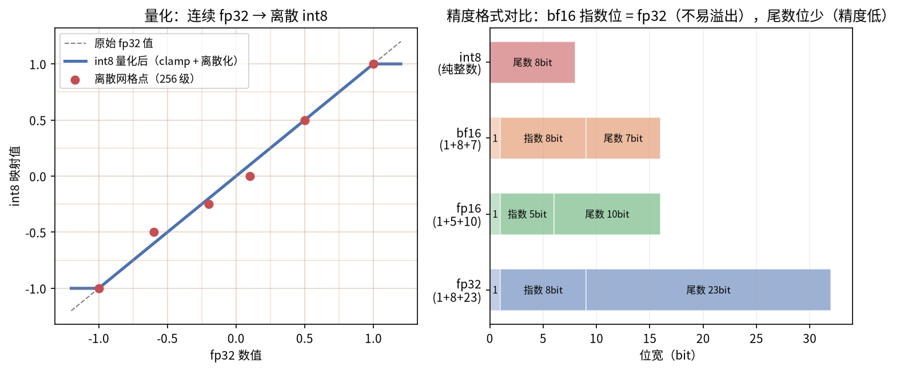
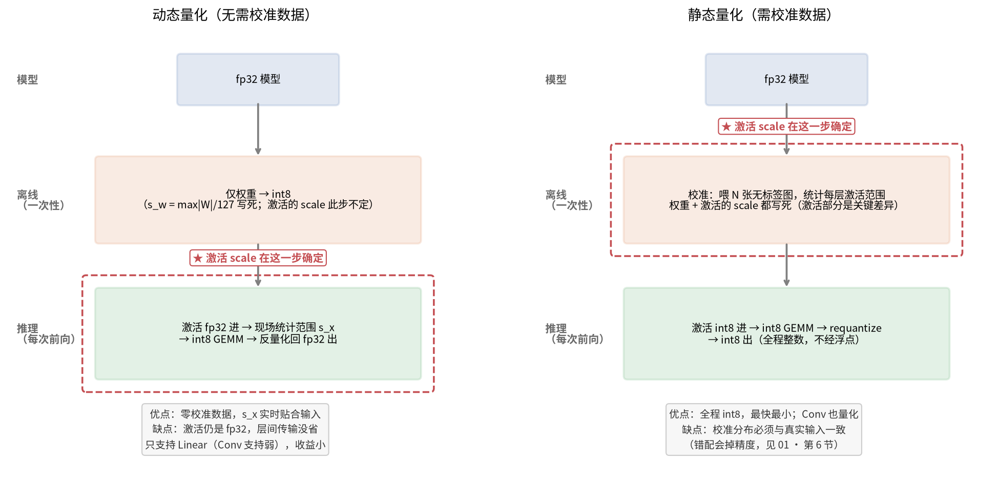
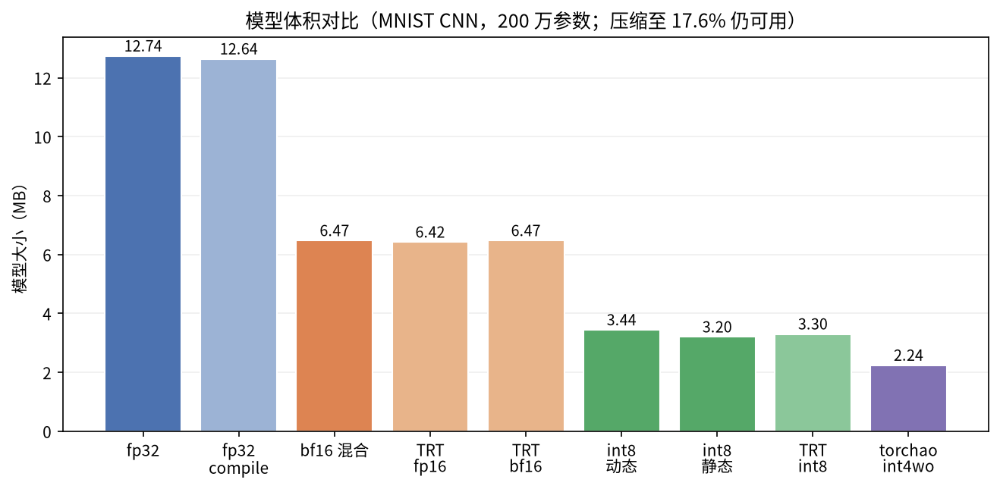
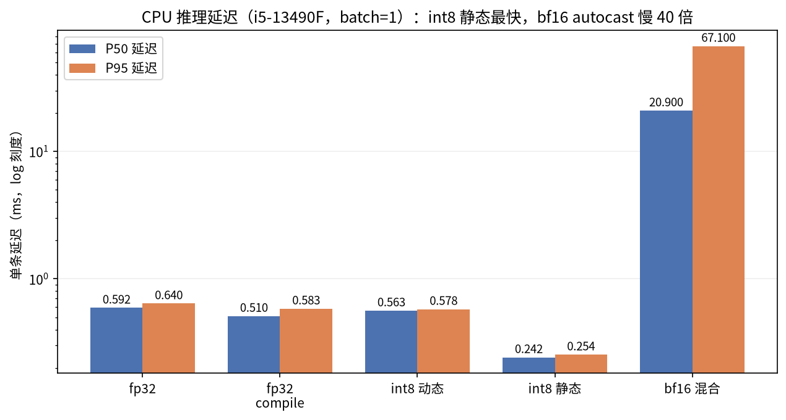
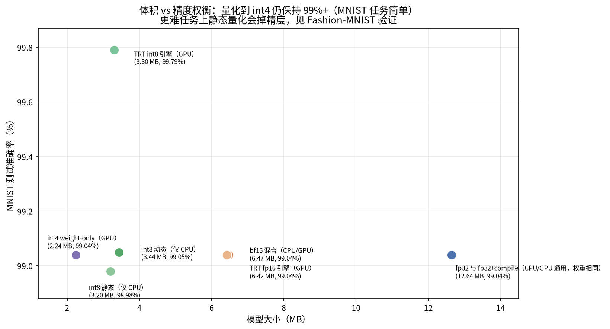

# 01 · 量化入门：从 fp32 到 int8，模型为什么能变小变快

> **学习目标**：理解量化是什么、为什么能换体积和速度、整数量化的动态/静态之分、以及会不会掉精度。
> **前置知识**：无，从这里开始。
> **本篇不覆盖**：浮点路线（fp16/bf16）、校准风险与 QAT、怎么选（[02 · 量化进阶](./02_quantization_advanced.md)）；同一精度在不同硬件上为什么快慢差 40 倍（[03 · 硬件架构](./03_hardware.md)）；性能数据怎么测才可信（[04 · 如何读懂性能数据](./04_reading_benchmarks.md)）。
>
> 所有结论都来自本项目的真实实验（MNIST CNN，200 万参数），复现命令见 [06 · 完整实验结果](./06_results.md)。深水区内容集中在 [05 · 量化深水区](./05_quantization_deep_dives.md)，初学可跳过，不影响主线。

## 1. 什么是量化

神经网络训练时权重是 **fp32**（32 位浮点数）。**[浮点数](./00_glossary.md)**（fp = floating point）就是二进制版的科学计数法：把一个数拆成「正负号 + 指数 + 尾数」三段来存——指数管数量级、尾数管有效数字（隐含首位等细节见术语表）。下面 fp32/fp16/bf16 的全部区别，就是这三段怎么分配。

**量化（广义）= 把 fp32 换成位数更少的格式存和算**，含两条技术路线：

- **整数路线（int8/int4）**：映射到等距整数格点，需要 **[scale](./00_glossary.md)** 换算——工业界狭义的"量化"常专指这条；
- **浮点路线（fp16/bf16）**：重排或截断位域、保留浮点语义，不需要 scale（TensorRT 亦称其为 FP16/BF16 quantization，展开见 [02 · 量化进阶](./02_quantization_advanced.md)）。

两条路线的机制差异是 §1 的主线，五种常见格式按路线分两组：

| 路线 | 格式 | 位域分配 | 数值范围 | 精度表现 |
|---|---|---|---|---|
| **浮点路线**（不需要 scale） | fp32 | 1 符号 + 8 指数 + 23 尾数 | 大（约 10^±38，指数位多） | 高（尾数位多，基线） |
| | fp16 | 1 符号 + 5 指数 + 10 尾数 | 小（约 ±65504，大值上溢成 inf） | 尚可（尾数 10 位） |
| | bf16 | 1 符号 + 8 指数 + 7 尾数（**指数位与 fp32 相同**） | 与 fp32 相同（训练时不易溢出）——**这正是大模型训练偏爱 bf16 的原因** | 低（尾数 7 位，为换范围付出的代价） |
| **整数路线**（需要 [scale](./00_glossary.md)） | int8 | 纯整数 8 位（-128~127） | 由 scale 锁定（对称量化实际只用 255 级，区别见 [05 · 深水区⑤](./05_quantization_deep_dives.md)） | 由 scale 粗细决定（三步公式见下） |
| | int4 | 纯整数 4 位（16 级） | 由 scale 锁定 | 16 级太粗：小权重被抹成 0，需 per-group（见 [05 · 深水区⑥](./05_quantization_deep_dives.md)） |

**整数量化（int8/int4）一个值的标准公式是三步：除以 scale → 四舍五入 → clip 到整数范围**（`q = min(qmax, max(qmin, round(x / s)))`）。第三步 clip 是必须的保险——不裁剪的话超出范围的值会溢出整数边界变成无关值。**无论动态还是静态，整数量化的精度问题都出在这个公式对 s 的依赖上**：s 怎么定（动态=现场算、静态=校准写死）决定了会不会出事、出哪种事，下面展开。



上图就是这三步的完整流程：面板①②③依次演示样本值如何被拉伸、取整、截断，面板④是各格式的位域划分。要记住：`q = clip(round(x / s))` 这个「除 scale → 取整 → clip」的公式**只适用于整数路线**——fp16/bf16 是浮点路线，不需要 scale，fp16 走位域重排（指数 8→5 要重归一化）、bf16 干脆就是 fp32 的前 16 位直接截断（细节见 [02 · §1.2 的对比表](./02_quantization_advanced.md#12-浮点转换不是没有误差与整数路线的逐项对比)）。两条路线的七维机制对比（公式/scale/误差/溢出等）都集中在那张表里，读到 02 篇时对照着看更清楚——§1 先把整数路线讲完。

**量化的本质是牺牲精度换体积和速度**：一个 fp32 数字占 4 字节，int8 只占 1 字节——理论上模型直接缩到 1/4。

## 2. 两条路线：PTQ 与 QAT

量化方法先按**"要不要重新训练"**分成两条路线，这是所有量化算法的第一层分类：

| 维度 | PTQ（训练后量化，Post-Training Quantization） | QAT（量化感知训练，Quantization-Aware Training） |
|---|---|---|
| 核心思想 | 模型已练完、权重不再动。**int 路线**：权重提前量化（s_w 由权重自身范围算出）；激活分两种——**静态**拿少量无标签数据**喂一遍模型，统计每层[激活](./00_glossary.md)的数值范围**、据此算出 scale 写死进模型，**动态**零数据、激活 scale 推理时现场算（**只有 int 路线才涉及 scale**）；**fp16/bf16 路线**：直接转换位域格式，没有 scale 这一步 | 允许再训练：训练时每层前向先「假装量化」（[fake-quant](./00_glossary.md)，见 [02 · 第 3 节](./02_quantization_advanced.md#3-q3-的终极解法qat校准四层防御也不够时)），让权重在梯度更新中**主动适应取整误差**（只服务 int 路线；fp16/bf16 转换无需 QAT——误差太小且训练时已在用，无需适应，见 [05 · 深水区②](./05_quantization_deep_dives.md)） |
| 需要什么 | **静态量化**需少量[校准](./00_glossary.md)数据（几百~几千张，不用标签）；**动态量化零数据**（激活范围推理时现场统计）；fp16/bf16 转换直接 cast，什么都不需要 | 完整训练集 + 标签 + 训练资源（微调几个 [epoch](./00_glossary.md)） |
| 成本 | 分钟级、零训练 | 本项目 3 epoch / 29 秒；大模型则数小时~数天 |
| 量化参数怎么定 | int 静态：统计校准数据的分布定激活 scale（min/max/分位数）；int 动态：无需数据（权重 scale 由权重自身范围定，激活 scale 现场算）；fp16/bf16：无需参数 | int 路线：scale 由 observer 同步统计、随权重分布更新（**非梯度学习**；LSQ 等进阶变体才把 scale 当可训练参数，见 [05 · 深水区⑮](./05_quantization_deep_dives.md)）；fp16/bf16：无需参数 |
| 为什么 QAT 通常更准 | **只有静态在"猜"**：激活 scale 是对未来数据分布的统计估计，猜得准不准取决于**分布匹配度**，猜错就集体截断（权重 scale 与动态量化的 s_x 都是精确计算，无猜测成分——动态的代价是离群值撑大步长，属确定性权衡而非估计误差） | 不猜：让梯度下降带着权重去适应写死的量化公式，模型自己找到对量化最鲁棒的解 |
| 精度 | **动态/fp16 普遍无损**（跨任务成立，见 [06 · §2.6](./06_results.md#26-fashion-mnist-鲁棒性验证量化损失是否普遍)）；**静态**分布匹配时无损、错配可能掉精度（[02 · 第 2 节](./02_quantization_advanced.md#2-q3int-路线的真正风险校准数据的分布必须与真实输入一致)就是分布错配的真实事故） | 通常**优于** PTQ 静态，甚至反超 fp32 基线（量化噪声当正则化） |
| 适用 | 快速部署、任务简单、拿不到训练管线 | PTQ 掉精度、精度敏感、训练管线可用 |

一句话类比：**PTQ 静态**是「按校准人群的身材做成衣、直接上身，不合身就认了」（重新校准 = 换一件再试）；**QAT** 是「边穿边改，改到合身」。**PTQ 动态**不在此类比内——它更像「每次试穿时现场量身、现调松紧」，永远不会"认了"，代价是每穿一次都要重新量（每层每批的统计开销）。所以工程实践是先用 PTQ（静态便宜、动态零校准），实测掉精度再上 QAT（本项目 Fashion-MNIST：PTQ 87.45% → QAT 93.95%，详见 [02 · 第 3 节](./02_quantization_advanced.md#3-q3-的终极解法qat校准四层防御也不够时)）。

第 3 节讲的动态/静态量化属于 **int 路线内部（PTQ）的两个子类**——浮点路线没有这个区分（没有 scale 可言）；接下来看它们的区别。

## 3. 整数量化再分类：动态 vs 静态

动态/静态的区分**只存在于整数路线**——浮点路线（fp16/bf16）没有 scale，不存在"scale 现算还是写死"的问题。两者都是 PTQ，且权重都在部署时提前量化为 int8；唯一的分水岭是**给激活配的 scale 是「用到时现算」（动态），还是「校准时量好、写死在模型里」（静态）**（scale = 浮点与整数之间的汇率，是量化附带的参数、随权重一起存进模型——不是激活本身）：

> **范围提示**：这对二分法覆盖的是"激活也被量化"的完整 int8 链路。整数路线还有第三种激活处理——**不量化**（weight-only，权重 int8/int4 + 激活保持浮点），动态/静态二分对它不适用，见 [02 · §1.4](./02_quantization_advanced.md#14-激活不量化的两种策略bf16-混合浮点路线vs-weight-only整数路线)。另外，本节的动态/静态都属于 **PTQ**（§2 两条路线之一）；QAT 是另一条独立的训练轴，它最终也落成**静态**形态（QAT→静态：convert 后 observer 移除、全部 scale 写死，推理与普通 int8 静态同一条链路），不与动态组合（语义错位）——四种实用组合的全景表见 [02 · §4](./02_quantization_advanced.md#4-q4怎么选场景与架构速查)。



**一句话总结**：两种方式的**权重**都在部署时量化为 int8（这一点相同），差别全在**激活**——动态量化的激活在每层输入时**现场算 scale 量化**、输出后**反量化回 fp32**（层间是浮点，每层一个"量化-反量化"来回）；静态量化的激活用写死的 scale 直接量化，输出 int32 经 **requantize** 变回 int8 传给下一层——层间全程 int8，但注意仍有轻量 requantize（int32→int8 不碰浮点、不算 scale），并非"零量化"（requantize 公式的推导、s_next 与 s_x 的区别，见 [05 · 深水区④](./05_quantization_deep_dives.md)）。下面用一个能逐行读懂的例子展开。

### 3.1 例子：同一层 fc1 在两种量化下如何执行

设某一层 fc1 要算 `y = W·x`（W 是权重矩阵，x 是输入激活）。**"量化"指的是把浮点数变成 `int8 = clip(round(fp32 / scale))`（clip 的作用见 [05 · 深水区⑦](./05_quantization_deep_dives.md)），scale 记录在旁边，算完再乘回去还原**。

**动态量化跑这层时**（权重提前量化，激活现场量化）：

```
部署时（离线，一次性）：
  W_fp32  ──→  W_int8 = clip(round(W / s_w))，s_w = max|W| / 127   ← 写进模型

推理时（每次前向，逐层重复）：
  ① x_fp32 进来
  ② 现场统计范围：s_x = max|x| / 127          ← 这一步就是"动态"
  ③ x_int8 = clip(round(x / s_x))             ← 量化激活
  ④ int8 GEMM：y_int32 = W_int8 × x_int8      ← 整数乘加，快
  ⑤ 还原：y_fp32 = y_int32 × s_w × s_x        ← 反量化回浮点
  ⑥ y_fp32 传给下一层                          ← 下一层又要从 ① 重新来
```

⑤ 之所以叫**反量化**：由量化定义 `W_int8 ≈ W_fp32 / s_w`、`x_int8 ≈ x_fp32 / s_x`，两式相乘正好得到 `y_int32 ≈ y_fp32 / (s_w × s_x)`——量化时除以 scale 把真值缩小装进整数域，反量化乘回 scale 还原，**一除一乘互为逆操作**（round 带来的 ±s/2 误差是唯一损耗，完整推导见 [05 · 深水区③](./05_quantization_deep_dives.md)）。

**静态量化跑这层时**（权重与激活的 scale 都在部署期算好，写死）：

```
部署时（离线，一次性）：
  W_fp32 ──→ W_int8 = clip(round(W / s_w))，s_w = max|W| / 127    ← 与动态量化相同

校准时（离线，喂 1024 张图）：
  对每层激活观察统计 max|x| → s_x              ← 与动态的 ② 相同公式，但只算这一次

推理时（每次前向）：
  ① x_int8 进来（上一层输出已是 int8，直接用）
  ② int8 GEMM：y_int32 = W_int8 × x_int8      ← 同样的整数乘加
  ③ requantize：y_int8 = clip(round(y_int32 × s_w × s_x / s_next))
                          ↑ 公式怎么来的、s_next 为何与 s_x 不同，见 [05 · 深水区④](./05_quantization_deep_dives.md)
  ④ y_int8 传给下一层
```

### 3.2 差异与优缺点总览

| 差异点 | 动态量化 | 静态量化 |
|---|---|---|
| s_x（激活 scale）哪来 | **每次前向现场算**（max 统计 + 除法 + round，全是开销） | 校准时算好，推理时查表 |
| 层间传递的数据 | fp32（算完就反量化回去了） | int8（requantize 直达下一层） |
| 可量化层 | Linear（Conv 的激活动态量化 kernel 不成熟，通常保持 fp32） | Conv + Linear（全图） |
| 数值精度 | s_x 反映当前批次的真实范围，最准；且 **s_x = max\|x\|/127 恒成立，最大值必落在 127 边界内，不触发 clip 截断**（这是 max 公式的性质——动态只规定"现场算"，若改用分位数公式则本批离群值会被截，但动态要控制运行时开销，主流实现 FBGEMM/oneDNN 均用 max；公式权衡见 [05 · 深水区⑧](./05_quantization_deep_dives.md)）。max 公式的代价：离群值会撑大 s_x，让其余值的步长变粗 | s_x 是校准集的统计近似，分布偏了就掉精度（四层防御见 [02 · §2](./02_quantization_advanced.md#2-q3int-路线的真正风险校准数据的分布必须与真实输入一致)） |
| **优点** | 零校准数据、即拿即用 | 最快最小；Conv 也量化；kernel 融合（= 多个算子合并成一个计算函数连续执行，省去中间结果读写——GPU 上是合成一个 CUDA 函数、CPU 上是合成一个指令集例程，详见 [03 · GPU 上发生了什么](./03_hardware.md#3-gpu-上发生了什么)与 [00_glossary](./00_glossary.md)） |
| **缺点** | 每层每次付统计/转换开销；层间 fp32 传输 | 需代表性校准集；分布偏移时 scale 失准 |
| **适合** | 快速集成、[Linear](./00_glossary.md) 为主的模型（为什么 BERT 类是 Linear 为主，见下方说明） | 卷积模型、追求极限速度/体积的生产部署 |

**为什么 BERT 类是"Linear 为主"**：BERT = N 层 Transformer 编码器堆叠，每个块由 Multi-Head Self-Attention（Q/K/V 三个 Linear 投影 + 输出 Linear）和 FFN（两个 Linear）组成——**没有卷积，参数和计算量 100% 由 Linear 承担**（GPT/LLaMA/ViT 等 Transformer 系同理）。这与 CNN 相反：MnistCNN 的计算大头是 Conv。所以动态量化（只量化 Linear）能覆盖 Transformer 的计算主体，对 CNN 则覆盖不足。

**但注意**：动态量化对 BERT 的价值是**零校准、快速验证**——它是"量化后精度掉多少"的第一步实验。生产上 BERT 类模型更常用静态量化（层间 int8 的全部收益）或 QAT/weight-only：BERT 激活范围随输入序列波动大，写死 scale 的收益/风险权衡需要按 [02 · 第 2 节](./02_quantization_advanced.md#2-q3int-路线的真正风险校准数据的分布必须与真实输入一致)实测。

### 3.3 实测与代价

本项目实测（CPU，i5-13490F）：

| 模型 | 大小 | [P50](./00_glossary.md) 延迟\* | 准确率（MNIST） |
|---|---|---|---|
| fp32 | 12.64 MB | 0.592 ms | 99.04% |
| int8 动态 | 3.44 MB | 0.563 ms | 99.05% |
| **int8 静态** | **3.20 MB** | **0.242 ms** | 98.98% |





> 图中出现了上表之外的几个模型形态，先混个脸熟不必深究：**bf16 混合**（延迟图里的 20.9 ms，慢 40 倍）属于浮点路线，展开见 [02 · §1](./02_quantization_advanced.md#1-q2量化的另一种形式浮点量化fp16bf16)，CPU 上为什么这么慢见 [03 · §2](./03_hardware.md#2-cpu-上发生了什么)；**TRT 系列与 torchao int4** 是 GPU 部署引擎与 weight-only 方案（[03](./03_hardware.md)、[02 · §1.4](./02_quantization_advanced.md#14-激活不量化的两种策略bf16-混合浮点路线vs-weight-only整数路线)、完整数据见 [06 · §1](./06_results.md#1-核心结论速查)）。本篇只需记住上图的主结论：**CPU 上 int8 静态最快、fp32 最慢于量化后形态**。

差距来源：动态量化每个 Linear 层每批数据都要做 ②③⑤ 三次转换，且层间 fp32 传输、Conv 保持浮点；静态量化把这些全部在离线付清，推理时是纯 int8 链路，所以快 2.3 倍。

**代价**：s_x 写死意味着如果真实输入的范围超出校准时的统计，量化值会饱和截断、精度受损（机制见 [05 · 深水区⑦](./05_quantization_deep_dives.md)）。

\* 表中延迟取的是 [P50](./00_glossary.md)（中位数）而非平均值——为什么看分位数，见 [04 · 为什么要看分位数](./04_reading_benchmarks.md#2-为什么要看分位数p50p95p99)。

## 4. Q1：量化会掉精度吗——各模型的精度/体积实测

§3.3 的"代价"听着吓人，实际上 MNIST 任务简单（99% 基线意味着模型"余量"很大），int8 的 255 级分辨率（对称量化，见 [05 · 深水区⑤](./05_quantization_deep_dives.md)）足够表达每层权重的相对大小——量化引入的扰动被模型的冗余吸收了。实验中量化到 **int4（16 级）**精度仍然无损（99.04%），GPU 上 TRT fp16 引擎（6.42 MB）精度也无损：



但这**不能推广到所有任务**——大模型的权重分布长尾更严重（这句话的具体含义与量化机制，见 [05 · 深水区⑩](./05_quantization_deep_dives.md)），对量化敏感得多。判断依据永远是：在你的任务上实测。

另外，"哪种量化手段适合我的模型"还与**架构**有关（Transformer 全是 Linear、CNN 以 Conv 为主，直接决定动态量化能否覆盖），对应表格见 [02 · §4 的选择指南](./02_quantization_advanced.md#4-q4怎么选场景与架构速查)。

## 本篇小结

- **量化（广义）两条路线**：整数路线（int8/int4，三步公式 `clip(round(x/s))`，需要 scale）与浮点路线（fp16/bf16，位域重排，不需要 scale——展开见 [02 · 量化进阶](./02_quantization_advanced.md)）。
- **要训练吗**：PTQ（不训练，先试，便宜）与 QAT（重新微调，掉精度时的终极解法，见 02 篇）。
- **int 路线内部再分（动态/静态，浮点路线无此区分）**：动态 = 激活 scale 现场按 max 算，零校准、只量化 Linear、天然免疫截断；静态 = scale 校准期写死，全图 int8、最快最小。
- **会掉精度吗**：MNIST 上量化到 int4 都无损（任务余量大）——**结论永远要在自己的任务上实测**；更难任务上静态量化的风险与解法（校准分布、QAT）见 [02 · 量化进阶](./02_quantization_advanced.md)。

## 自测：你学会了吗

<details>
<summary>1. 整数量化的标准公式是哪三步？clip 这一步为什么不能省？</summary>

除以 scale → 四舍五入 → clip 到整数范围。clip 是必须的保险：不裁剪的话，超出范围的值会溢出整数边界变成无关值。无论动态还是静态，整数量化的精度问题都出在这个公式对 s（scale）的依赖上；差别在 s 怎么定——动态现场按 max 算（免疫截断但离群值撑大步长），静态校准写死（分布错配会集体截断）。
</details>

<details>
<summary>2. （进阶）int8 对称量化为什么只用 255 级，而不是 256 级？</summary>

256 是位模式总数（-128~127）。对称量化的 s = max|x|/127 只映射到 [-127, 127] 共 255 个格：主动牺牲 -128，换取正负对称（q(−x) = −q(x)、0 值精确映射）和整齐的乘加范围。用满 256 级的是非对称量化（0~255），但要额外存 zero-point。（机制详见 [05 · 深水区⑤](./05_quantization_deep_dives.md)）
</details>

<details>
<summary>3. 动态量化和静态量化最核心的区别是什么？</summary>

激活的 scale 什么时候确定：动态量化每次前向现场统计范围再算（零校准数据但每层每次付开销、只量化 Linear）；静态量化在校准期统计好写死（推理全程 int8 最快，但校准分布必须与真实输入一致）。
</details>

<details>
<summary>4. 量化到 int4 都无损，这个结论能直接用到你的模型上吗？</summary>

不能直接照搬。MNIST 任务简单（99% 基线意味着模型"余量"很大）、权重分布短尾；大模型权重分布长尾更严重，对量化敏感得多（机制见 [05 · 深水区⑩](./05_quantization_deep_dives.md)）。判断依据永远是：在你的任务上实测——更难任务上的实测结果见 [02 · 第 2 节](./02_quantization_advanced.md#2-q3int-路线的真正风险校准数据的分布必须与真实输入一致)。
</details>

---

下一篇：[02 · 量化进阶：浮点路线、校准风险与 QAT](./02_quantization_advanced.md)
