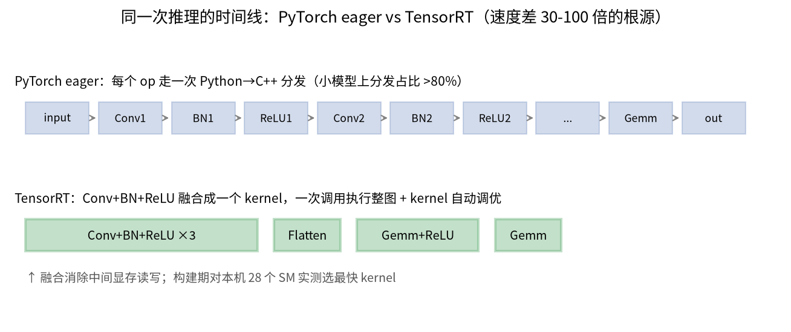

# 01 · 量化入门：从 fp32 到 int8，模型为什么能变小变快

> 面向初学者。读完后你会理解：量化是什么、动态/静态量化的区别、为什么不同精度在不同硬件上快慢不同。所有结论都来自本项目的真实实验（MNIST CNN，200 万参数），复现命令见文末。

## 1. 什么是量化

神经网络训练时权重是 **fp32**（32 位浮点数）。量化就是把这些数换成更短的格式存储和计算：


- **fp32**：1 位符号 + 8 位指数 + 23 位尾数。指数位多 → 数值范围大（约 10^±38）；尾数位多 → 精度高。
- **fp16**：指数 5 位、尾数 10 位。范围小（约 ±65504），大数值会溢出。
- **bf16**：**指数位与 fp32 相同（8 位）**、尾数 7 位。范围和 fp32 一样大（训练时不易溢出），但精度低——这就是大模型训练偏爱 bf16 的原因。
- **int8**：纯整数 256 级（-128~127）。需要一个 **scale（缩放系数）** 把浮点范围映射进来。

**量化的本质是牺牲精度换体积和速度**：一个 fp32 数字占 4 字节，int8 只占 1 字节——理论上模型直接缩到 1/4。

## 2. 动态量化 vs 静态量化（本项目的核心实验）

两者都是"训练后量化"（PTQ，不需要重新训练），区别在于**激活值的 scale 什么时候确定**：


**动态量化**（`quantize.py`）：
- 只把**权重**提前转成 int8（导出时一次完成）；
- **激活保持 fp32**，推理时每个 Linear 层现场计算当前输入的范围再量化；
- 优点：不需要任何校准数据，简单；缺点：激活是 fp32，层间传输和计算没省，且只对 Linear 有效（Conv 支持弱）。

**静态量化**（`quantize_static.py`）：
- 先喂几百到几千张**代表性数据**（校准集），统计每层激活值的分布范围，把权重和激活的 scale **全部提前算好写死**；
- 推理时激活以 int8 形式在层间流动，全程整数运算；
- 优点：最快最小（Conv 也能量化 + 走融合 kernel）；缺点：校准数据不具代表性时会掉精度（见第 5 节的真实教训）。

本项目实测（CPU，i5-13490F）：

| 模型 | 大小 | P50 延迟 | 准确率（MNIST） |
|---|---|---|---|
| fp32 | 12.64 MB | 0.592 ms | 99.04% |
| int8 动态 | 3.44 MB | 0.563 ms | 99.05% |
| **int8 静态** | **3.20 MB** | **0.242 ms** | 98.98% |

静态量化比动态快 2.3 倍——因为 Conv 也被量化了（模型参数量大头在 Conv），且没有运行时量化的开销。

## 3. 混合精度：不是所有层都该降精度

**bf16 混合精度**（`quantize.py` 里的 `make_bf16_mixed`）：大部分层权重转 bf16，但**敏感层保留 fp32**——首层 conv（直接接触原始像素）、全部 BatchNorm（统计量对精度敏感）、最终分类层（logits 差一点就分错类）。实测精度无损（99.04% → 99.04%）。

**weight-only 量化**（`bench_torchao.py`）：权重存 int8/int4，激活保持 bf16。适合显存敏感的大模型场景；本实验的小模型上速度收益不明显。

## 4. 量化后为什么精度几乎不掉

MNIST 任务简单（99% 基线意味着模型"余量"很大），int8 的 256 级分辨率足够表达每层权重的相对大小。实验中量化到 **int4（16 级）**精度仍然无损（99.04%，见 `tradeoff_scatter.png`）：


但这**不能推广到所有任务**——大模型的权重分布长尾更严重，对量化敏感得多。判断依据永远是：在你的任务上实测。

## 5. 真实教训：校准数据的分布必须与真实输入一致

在更难的 Fashion-MNIST（fp32 基线 92.68%）上重复了全部量化流程（`verify_fmnist.py`）：

| 模型 | 准确率 | 损失 |
|---|---|---|
| bf16 混合 | 92.68% | 0.00% |
| int8 动态 | 92.66% | -0.02% |
| **int8 静态** | **87.45%** | **-5.23%** ⚠️ |

bf16/动态量化的"无损"是普遍规律。静态量化掉的 5 个点，最初以为是校准数据不足——但校准研究（`calibration_study.py`）推翻了这个直觉：

- **同数据集校准**：256 张和 16384 张一样，都只掉 0.2%，MinMax/Histogram 方法差异也不大；
- **跨数据集校准**（本项目的事故：静态量化脚本硬编码用 MNIST 数据校准 Fashion-MNIST 模型，归一化参数都不同）：掉 5.3%，且加更多错分布的数据救不回来。

**生产准则：校准数据的分布与真实输入一致（同样预处理/归一化），比数据量和校准方法重要得多。** 校准掉精度的标准解法是 QAT（下一节）。

## 6. QAT：静态量化掉精度的标准解法

QAT（量化感知训练）：把 fake-quant 节点插进模型，**边训练边让权重适应量化约束**。`qat_study.py` 在同一 Fashion-MNIST 任务上：

| 方案 | 准确率 |
|---|---|
| PTQ（校准错配） | 87.45% |
| fp32 基线 | 92.68% |
| **QAT（微调 3 epoch，29 秒）** | **93.95%** |

QAT 比 PTQ 恢复 6.5 个百分点，且**反超 fp32 基线 1.3%**（fake-quant 的量化噪声起到了正则化作用）。成本极低，是静态量化掉精度时的首选解法。

## 7. 部署引擎：为什么 TensorRT 能再快 30-100 倍

同样的模型，PyTorch eager GPU 吞吐 1.8k 条/秒，TensorRT 引擎 10 万+ 条/秒。差距不在精度，在**执行方式**：



1. **无 Python 分发**：eager 每个 op 都走一次 Python→C++ 分发，小模型单层计算只要几微秒，分发开销占比超 80%；
2. **算子融合**：Conv+BN+ReLU 融合成一个 kernel，消除中间显存读写；
3. **kernel 自动调优**：构建期对你这块 GPU 实测几十种实现选最快的。

**注意**：PyTorch 的 `quantize_dynamic` 只有 CPU 实现（依赖 oneDNN/FBGEMM），int8 想在 GPU 上跑必须走 TensorRT（QDQ 显式量化）或 torchao。

## 8. 快速选择指南

| 场景 | 推荐 | 理由 |
|---|---|---|
| CPU 部署 | **int8 静态量化** | 最快（2.4×）最小（3.2MB），注意校准集质量 |
| CPU 快速集成 | int8 动态量化 | 无需校准数据，精度最稳 |
| GPU（消费卡） | **TensorRT fp16** | 零精度损失、吞吐最高（32 万条/秒） |
| GPU 体积敏感 | TensorRT int8 | 3.3 MB，需校准集 |
| 静态量化掉精度 | **QAT 量化感知训练** | 本实验恢复 6.5% 且反超基线，成本极低 |
| 大模型训练 | bf16 混合精度 | 指数位与 fp32 相同，不易溢出 |
| 大模型显存敏感 | torchao weight-only | int8/int4 权重 + bf16 激活 |

## 复现

```bash
conda run -n py312 python src/train.py            # 训练 fp32 基线
conda run -n py312 python src/quantize.py         # 动态量化 + bf16 混合
conda run -n py312 python src/quantize_static.py  # 静态量化
conda run -n py312 python src/verify_fmnist.py    # Fashion-MNIST 鲁棒性验证
conda run -n py312 python src/calibration_study.py  # 校准研究（分布匹配 > 数据量）
conda run -n py312 python src/qat_study.py        # QAT vs PTQ
conda run -n py312 python src/resnet18_study.py   # ResNet-18 普适性验证
```

下一篇：[02 · 硬件架构：为什么同一模型在不同硬件上快慢差 40 倍](./02_hardware.md)
