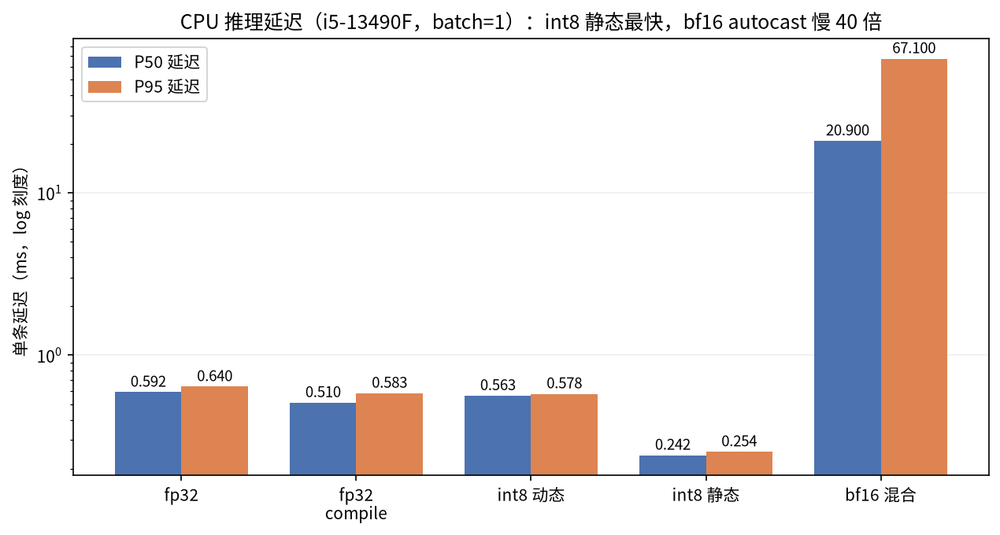
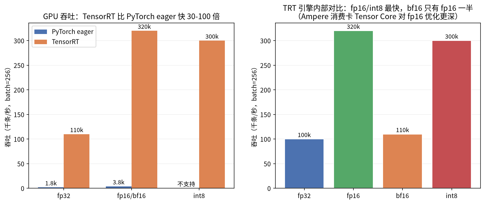
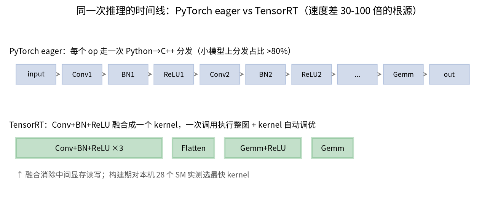
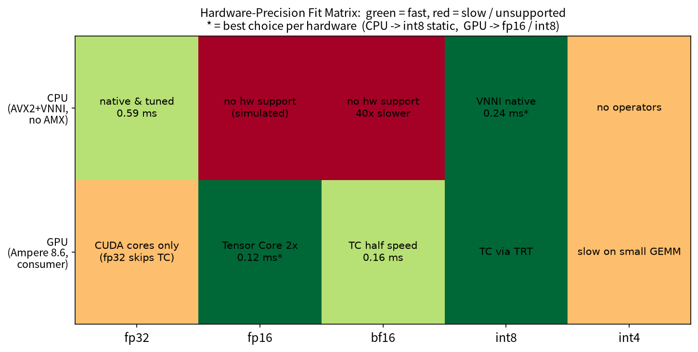

# 03 · 硬件架构：为什么同一模型在不同硬件上快慢差 40 倍

> **学习目标**：理解 CPU 和 GPU 分别怎么算神经网络、指令集是什么、为什么同一精度在不同硬件上速度差 40 倍，以及部署前如何检查目标硬件。
> **前置知识**：读完 [01 · 量化入门](./01_quantization_basics.md)与 [02 · 量化进阶](./02_quantization_advanced.md)（认识 fp32/int8/bf16 等精度格式）。
> **本篇不覆盖**：这些速度数字是怎么测出来的（[04 · 如何读懂性能数据](./04_reading_benchmarks.md)）。
>
> **预计学习时长**：约 12 分钟。
>
> 核心结论一句话：**精度格式的实际速度取决于硬件是否为它提供原生执行单元，软件只是把硬件能力翻译出来。** 深水区内容集中在 [05 · 量化深水区](./05_quantization_deep_dives.md)（本篇对应 ⑪-⑭），初学可跳过，不影响主线。

本篇的展开方式：先用两个最反直觉的实验现象提问（bf16 在 CPU 上慢 40 倍、在 GPU 上反而快一倍），再看 CPU/GPU 内部发生了什么来回答，最后把所有现象收进一张硬件-精度匹配矩阵。

## 1. 本机硬件规格（实测）

> 初学可跳过本节，后文用到具体数字（如 AVX_VNNI、28 个 SM）时回查即可。

### CPU：Intel Core i5-13490F（Raptor Lake 消费级，2023）

| 项目 | 规格 |
|---|---|
| 架构 | x86-64，P 核 + E 核混合（6P ×2 超线程 + 4E = 16 线程） |
| 频率 | 最高 4.8 GHz |
| 缓存 | L1d 416 KiB / L2 9.5 MiB / L3 24 MiB |
| 向量指令集 | AVX2、FMA、**AVX_VNNI** |
| **关键缺失** | **无 AVX-512（因此无 AVX512-BF16）、无 AMX**（AMX 只在服务器 Xeon 上） |

### GPU：NVIDIA GeForce RTX 3060 12GB（Ampere，GA106）

| 项目 | 规格 |
|---|---|
| 计算能力 | 8.6（Ampere 架构） |
| 流式多处理器 | 28 个 SM |
| CUDA 核心 | 3,584 个（fp32/fp16 通用单元） |
| Tensor Core | 每 SM 4 个（第三代：FP16/BF16/INT8/INT4 矩阵乘专用单元） |
| 显存 | 12 GB GDDR6，192-bit，约 360 GB/s |
| L2 缓存 | 2.25 MB（实测） |

## 2. CPU 上发生了什么

CPU 做神经网络计算，靠的是 **[SIMD](./00_glossary.md) 向量指令**：一条指令同时处理多个数据。

- `AVX2`：256 位宽向量寄存器 → 一条指令做 8 个 fp32 加/乘；
- `FMA`：乘加融合，一条指令完成 a×b+c；
- `AVX_VNNI`：int8 点积专用，一条指令完成 4 组 8-bit 乘加（`vpdpbusd`）——int8 乘加主体走 VNNI，[requantize](./00_glossary.md)/裁剪/搬移等辅助运算仍走 AVX2，两者配合构成完整 int8 推理路径；
- `AVX512-BF16` / `AMX`：bf16 向量运算 / 瓦片矩阵乘——**本机没有**。

**为什么 bf16 在 CPU 上慢 40 倍**（22.4 vs 0.573 ms；数字来自本篇批次的实测，[01](./01_quantization_basics.md) 的 20.9/0.592 ms 是另一批，批间波动 ±3%）：



1. 没有 bf16 执行单元 → [oneDNN](./00_glossary.md) 检测后走**仿真路径**：bf16 → fp32 转换 → fp32 计算 → 转回 bf16。运算量一点没省，还多了两次转换；
2. **batch=1 时固定开销占满延迟**：每层计算只要几十微秒，但每次 forward 都要把几 MB 权重转一遍 dtype，这套开销不变——计算越少，转换占比越高；
3. fp32 路径有十几年优化（寄存器分块、缓存预取）+ 4.8 GHz 高频，本来就极快。

**为什么 int8 在 CPU 上反而最快**（0.242 ms）：

- 量化是**一次性完成、写死进模型**的，推理时直接 int8 运算，没有反复转换；
- AVX_VNNI 原生支持 int8 点积；
- 权重体积减半 → 内存带宽压力减半（CPU 小模型推理的瓶颈常在内存访问而非计算）。

## 3. GPU 上发生了什么

GPU 靠**海量并行**：3,584 个 [CUDA 核心](./00_glossary.md)同时算不同数据，矩阵乘还有专用的 **[Tensor Core](./00_glossary.md)**。

**为什么 bf16 在 GPU 上快一倍**（0.266 vs 0.564 ms）：RTX 3060 的第三代 Tensor Core 原生支持 BF16 矩阵乘，PyTorch 的 [`autocast(bf16)`](./00_glossary.md) 把 conv/[GEMM](./00_glossary.md) 分派给 Tensor Core，吞吐直接翻倍。batch=256 时计算量大，转换开销摊薄可忽略。

**为什么 TRT bf16 只有 TRT fp16 一半**（约 110k vs 320k 条/秒）——本机 GPU 上最有意思的结果：



- **硬件层面的直接原因**：Tensor Core 是固定功能电路，吞吐由芯片设计决定。Ampere 白皮书对 GA10x（RTX 3060 的 GA106 属于此系）的配置是：每个 SM 每 clock 的 FP16 Tensor 吞吐 256 FMA，**BF16 Tensor 吞吐 128 FMA——物理上只有一半的乘法阵列**。TRT 实测 bf16 kernel 比 fp16 慢，反映的就是这个电路比值，不是软件没调优。
- **为什么厂商这么配：市场定位**。fp16 是消费卡的主场（游戏光影、DLSS、创作渲染都以 fp16 为主力），所以 GA10x 给 fp16 配满吞吐；bf16 存在的理由是深度学习训练（指数位与 fp32 相同不溢出），训练发生在数据中心卡上——A100 的 FP16 与 BF16 Tensor 吞吐完全相等（都是 312 [TFLOPS](./00_glossary.md)），消费卡则作为产品分层"能跑但减半"（A100 当时卖 1 万多美元，RTX 3060 卖 300 多）。
- **bf16 的速度谱系（取决于硬件是否把它当一等公民）**：

| 硬件 | bf16 vs fp16 | 原因 |
|---|---|---|
| 消费卡（本机 3060，GA10x） | **一半** | BF16 乘法阵列只有 FP16 的一半 |
| 数据中心卡（A100/H100） | 相等 | 为训练服务，吞吐对齐 |
| CPU（本机 i5，无 AVX512-BF16/AMX） | 两者都慢 40 倍 | 都无原生支持，走仿真 |

- 结论：**bf16 的价值在训练（不溢出）和数据中心卡（吞吐对齐）；消费级 GPU 推理选 fp16 永远不会吃亏**（要么更快要么持平）。

**为什么 TensorRT 比 PyTorch eager 快 30-100 倍**（1.8k → 10 万+ 条/秒）——差距不在精度在执行方式：



| 提速来源 | eager 的问题 | TRT 的做法 | 收益 |
|---|---|---|---|
| 无 Python 分发 | 每个 [op（算子）](./00_glossary.md)走一次 Python→C++ 分发，小模型单层计算只要几微秒，分发占比 >80% | 引擎是编译好的 CUDA [kernel](./00_glossary.md) 序列，一次调用执行整图 | 消除调度开销 |
| 算子融合 | Conv/BN/ReLU 每层单独执行，中间结果反复读写显存 | Conv+BN+ReLU 融合成一个 kernel | 消除中间显存读写 |
| kernel 自动调优 | 通用 kernel，不针对具体 GPU 形状 | 构建期对本机 GPU 实测几十种实现选最快 | 针对 28 个 SM 精调 |

**注意**：PyTorch 的 `quantize_dynamic` 只有 CPU 实现（依赖 oneDNN/FBGEMM），int8 想在 GPU 上跑必须走 TensorRT（QDQ 显式量化）或 torchao。

### GPU 上的 kernel 是谁实现的——cuDNN/cuBLAS 的角色

§2 讲过 CPU 侧的 oneDNN；GPU 侧对应的是 **cuDNN**（conv/pooling/BN/激活等深度学习原语）和 **cuBLAS/cuBLASLt**（GEMM 矩阵乘）——NVIDIA 提供的加速库。但它们不是唯一的 kernel 来源，完整图景是三层：

| 层 | 角色 | GPU 侧 | CPU 侧 |
|---|---|---|---|
| 框架 | 决定"调用哪个实现" | PyTorch eager / TensorRT / torch.compile | 同左 |
| 加速库 | 提供**现成的 kernel 集合与挑选机制**（每个算子内部几十种实现，按张量形状/硬件实测选） | cuDNN（conv 类主力）、cuBLASLt（GEMM） | oneDNN |
| 自生成 kernel | 框架自己编译生成的特化 kernel | TensorRT 自家 kernel、torch.compile 的 Triton 生成 | oneDNN JIT |

由此澄清一个易混点：**cuDNN 不是"kernel 融合"的发生地**——它提供单个算子的 kernel 候选；把 Conv+BN+ReLU+requantize 合并成一个 kernel 的融合，发生在框架层（TRT 构建期 / torch.compile 编译期 / oneDNN 的图模式）。TRT 构建期"实测几十种实现选最快"的候选来源就是自家 kernel + cuDNN + cuBLASLt。

### 补充深入：`.to("cuda")` 之后，每个 kernel 都要写回显存吗

要——`.to("cuda")` 只是把数据搬进显存，**不改变 GPU 上独立 kernel 的执行约定**。GPU 的内存是分层的，一次独立 kernel 执行的数据流：

```
全局显存（HBM，12 GB，~360 GB/s）
   ↓ 读入
L2 缓存（2.25 MB）→ 寄存器 / shared memory（SM 内，最快）→ 计算
   ↓ 结果写回全局显存
```

单个 kernel（如独立的 Conv）**结束时必须把输出写回全局显存**——下一个 kernel（如 ReLU）要从显存把它读出来，即使数据物理上还在 L2 里，逻辑上也是两次内存事务加一次 kernel 边界同步。这就是上表"消除中间显存读写"的展开：**融合后，ReLU 的输入是 Conv 结果在寄存器里的值，数据不落全局显存，只有最终输出写一次**。

两个易混点：

- **异步执行不影响这个结论**：PyTorch 的算子调用是异步的（Python 不等 kernel 跑完），但 kernel 之间仍有数据依赖（ReLU 必须等 Conv 写完才能读），依赖链上的 kernel 无法重叠——融合正是把依赖链在硬件层面缩短；
- **"写回显存"的代价对小模型反而更显著**：28×28 张量的计算本身只要几微秒，而 kernel 启动 + 同步 + 内存事务的固定开销每次几微秒——计算越轻，这些开销占比越高（与 CPU 上"分发占比 >80%"同一逻辑）。

## 4. 硬件-精度匹配矩阵（把前面的现象收进一张地图）



**图中术语说明**（矩阵每格三行：计算单元/指令集 → 测试框架 → 耗时）：

| 术语 | 说明 |
|---|---|
| AVX2 / FMA | x86 向量指令（256 位宽）：`vaddps`/`vmulps` 一条指令 8 个 fp32 加/乘，FMA（`vfmadd231ps`）一条指令 8 组乘加；也支持 int8/int32 的加减与按位运算。fp32 推理的乘加主体 |
| AVX_VNNI | int8 点积专用指令（`vpdpbusd`），一条指令 4 组 × 8 对 int8 乘加进 int32 累加器；不支持 fp32 运算。与 AVX2 配合（乘加走 VNNI，requantize/搬移/裁剪走 AVX2）构成完整 int8 推理路径 |
| AMX | Intel 服务器 CPU 矩阵引擎（Sapphire Rapids+），消费级桌面 CPU 没有；与 AVX512 的区别见 [05 · 深水区⑭](./05_quantization_deep_dives.md) |
| oneDNN | Intel CPU 深度学习算子库（PyTorch CPU 后端）；无硬件支持时用 fp32 模拟 fp16/bf16 |
| CUDA cores | NVIDIA 通用 FP32 单元；fp32 在这里跑（Tensor Core 不支持 fp32 矩阵乘） |
| Tensor Core (TC) | NVIDIA 矩阵乘专用单元（Ampere 三代：fp16/bf16/int8/int4），无 fp32 模式（fp32 想走 TC 需 tf32 截断路径，本实验未开启，见 [05 · 深水区⑬](./05_quantization_deep_dives.md)） |
| TRT / int8 QDQ | TensorRT 推理引擎；QDQ = 通过 Quantize/Dequantize 节点的显式量化 |
| tinygemm | CUDA int8/int4 weight-only GEMM kernel（torchao），按组反量化权重 |
| PyTorch eager | PyTorch 默认逐算子执行方式（无图编译/融合） |
| not tested | int4 在 CPU 上无算子（PyTorch/torchao 均未实现），本项目未测耗时 |

### 精度格式对照表

位域结构与数值范围的完整定义见 [01 · 量化入门](./01_quantization_basics.md#1-什么是量化)，此处只列与本机硬件实测直接相关的维度（各格式每步运算的精度行为差异——为什么 int8 乘加精确、浮点损失在乘法输入端，见 [05 · 深水区⑪](./05_quantization_deep_dives.md)）：

| 格式 | 位宽 | 本机 CPU（AVX2+VNNI） | 本机 GPU（Ampere 8.6） | 典型用途 |
|---|---|---|---|---|
| fp32 | 32 bit | 一等公民（0.59 ms） | 走 CUDA cores（无 TC 支持） | 训练金标准、精度兜底 |
| bf16 | 16 bit | 无原生支持（仿真，慢 40 倍） | TC 半速（消费卡差异） | 大模型训练（不易溢出） |
| fp16 | 16 bit | 无原生支持（仿真，慢 40 倍） | **TC 全速（消费卡主场）** | GPU 推理首选 |
| int8 | 8 bit | **最快（VNNI 原生）** | TC 经 TRT | CPU 部署首选 |
| int4 | 4 bit | 无算子 | TC（tinygemm，小矩阵不快） | 显存敏感的大模型权重 |

**CPU 行**：fp32 是一等公民（0.59ms）；int8 最快（VNNI 原生，0.24ms）；fp16/bf16 **没有原生支持**，oneDNN 走仿真路径——慢 40 倍。

**GPU 行**：fp16 最快（Tensor Core 双倍吞吐）；bf16 快但只有 fp16 一半（消费卡差异，见第 3 节）；int8 需 TRT 才有 GPU kernel。

## 5. 一张表总结

| 精度 | CPU（AVX2+VNNI，无 AMX） | GPU（Ampere 8.6 消费卡） |
|---|---|---|
| fp32 | 快（一等公民 + 高频）0.59ms | 一般（无 Tensor Core） |
| fp16 | 无原生支持（仿真）22.1ms | **最快**（TC 双倍吞吐）0.12ms |
| bf16 | 无原生支持（**最慢**）22.4ms | 较快但只有 fp16 一半 0.16ms |
| int8 | **最快**（VNNI + 带宽减半）0.24ms | 快（需 TRT；TC 支持） |

规律：**同一精度格式在不同硬件上速度可以差 40 倍，决定因素是硬件有没有为它造专用执行单元。** 选精度之前，先看目标硬件的指令集/架构支持。

## 6. 给初学者的检查清单

部署前问三个问题：

1. **目标 CPU 有什么指令集？** `lscpu | grep -o 'avx[^ ]*\|amx[^ ]*'`——有 AVX_VNNI 选 int8，有 AVX512-BF16/AMX 才考虑 bf16；
2. **目标 GPU 什么架构？** `nvidia-smi --query-gpu=compute_cap --format=csv`——8.6+ 才有 bf16/INT8 Tensor Core；FP8 要 8.9+（Ada/40 系）；
3. **用什么推理引擎？** PyTorch 的 int8 量化只有 CPU 实现；GPU int8 走 TensorRT（QDQ 显式量化）或 torchao；追求极致吞吐一律 TensorRT。

## 本篇小结

- CPU 靠 SIMD 向量指令（AVX2/FMA/VNNI）算神经网络；GPU 靠海量并行 + Tensor Core 专用矩阵乘单元。
- bf16 慢 40 倍/快一倍/只有 fp16 一半，三个现象同一个根源：**硬件有没有为这种格式造原生执行单元、造了多少**。
- TRT 快 30-100 倍的根源是执行方式（无 Python 分发 + 算子融合 + kernel 调优），不是精度。
- 下一篇解决实操问题：这些速度数字该怎么测才可信——[04 · 如何读懂性能数据](./04_reading_benchmarks.md)。

## 自测：你学会了吗

> 建议先不看答案自答，再展开对照。难度标注：基础 = 正文可直接查到；进阶 = 需要推导或跳查深水区。

**基础**

<details>
<summary>1.【基础】同一个 bf16 模型，为什么在 CPU 上慢 40 倍、在消费级 GPU 上却比 fp32 快一倍？</summary>

同一根源：硬件有没有为 bf16 造原生执行单元。CPU（i5-13490F）没有 AVX512-BF16/AMX，oneDNN 走仿真路径（转 fp32 再算，还多两次转换）；RTX 3060 的 Tensor Core 原生支持 BF16 矩阵乘，吞吐翻倍。
</details>

<details>
<summary>2.【基础】消费级 GPU 上，TRT bf16 的吞吐为什么只有 TRT fp16 的一半？</summary>

Tensor Core 是固定功能电路：Ampere GA10x 每 SM 每 clock 的 FP16 Tensor 吞吐 256 FMA、BF16 只有 128 FMA——物理上乘法阵列就少一半。原因是市场定位：fp16 是消费卡主场，bf16 服务数据中心训练卡（A100 上两者相等）。
</details>

<details>
<summary>3.【基础】TRT 比 PyTorch eager 快 30-100 倍，根源是什么？</summary>

执行方式而非精度：无 Python 分发（引擎一次调用执行整图）、算子融合（Conv+BN+ReLU 一个 kernel）、kernel 自动调优（构建期对本机 GPU 实测选最快实现）。
</details>

<details>
<details>
<summary>4.【进阶】为什么 int8 在 CPU 上反而最快，而 bf16 最慢？</summary>

三个原因：量化是一次性完成、写死进模型的，推理时直接 int8 运算，没有反复转换；AVX_VNNI 指令原生支持 int8 点积；权重体积减半 → 内存带宽压力减半（小模型推理瓶颈常在内存访问）。bf16 则完全没有原生执行单元，只能走仿真。
</details>

<details>
<summary>5.【基础】部署前应该对目标硬件检查哪三件事？</summary>

① CPU 指令集（lscpu 查 AVX_VNNI/AVX512-BF16/AMX）；② GPU 架构（nvidia-smi 查 compute capability，8.6+ 才有 bf16/INT8 Tensor Core）；③ 推理引擎（PyTorch int8 只有 CPU 实现，GPU int8 走 TRT/torchao）。
</details>

<details>
<summary>6.【进阶】int8 的乘加本身有舍入误差吗？</summary>

没有。int8×int8 的乘积完整落在 int32 里，乘加是纯精确整数运算；int8 的全部误差发生在进入整数域之前的量化映射（round + clip）那一步。浮点格式（bf16/fp16）则相反——误差在乘法输入端截断尾数。（完整的乘法/加法精度行为对比见 [05 · 深水区⑪](./05_quantization_deep_dives.md)）
</details>

---

上一篇：[02 · 量化进阶](./02_quantization_advanced.md) | 下一篇：[04 · 如何读懂性能数据](./04_reading_benchmarks.md)
