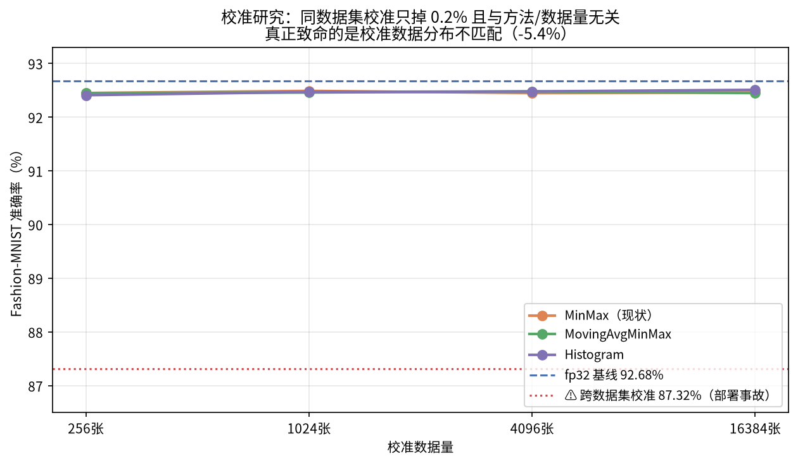
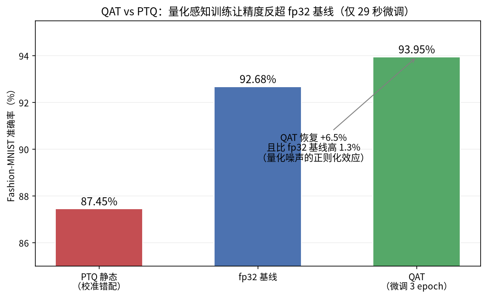
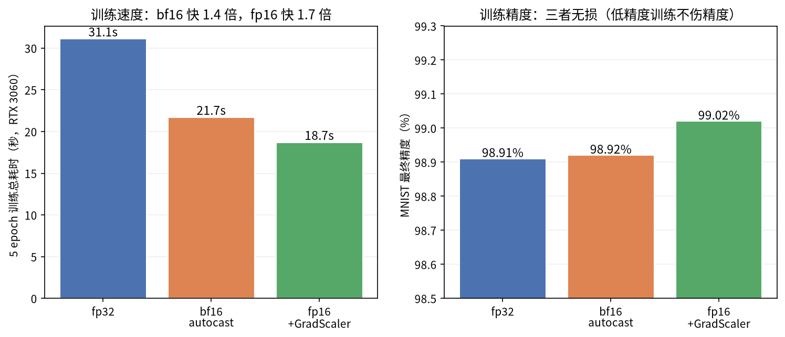
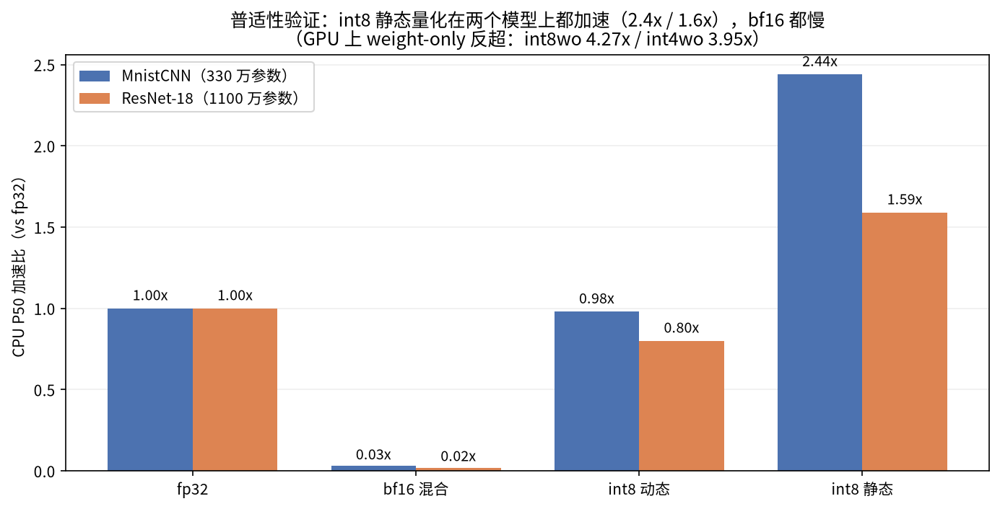

# MNIST 模型量化对比：fp32 vs bf16 混合精度 vs int8 混合精度

- 环境：conda `py312`（Python 3.12.12），PyTorch 2.6.0+cu124，RTX 3060 GPU，i5-13490F 16 核 CPU
- 模型：自定义 CNN（Conv-BN-ReLU ×3 + FC ×2，约 200 万参数）
- 训练：fp32、5 epoch、Adam lr=1e-3、batch 256，GPU 训练

## 结果汇总

| 指标 | fp32 基线 | bf16 混合精度 | int8 混合精度 |
|---|---|---|---|
| 测试集准确率 | 99.04% | 99.04% | **99.05%** |
| 模型文件大小 | 12.64 MB | 6.47 MB（-48.8%） | **3.44 MB（-72.8%）** |
| CPU 延迟（batch=1） | 0.573 ms/条 | 22.433 ms/条（⚠️ autocast 开销） | **0.553 ms/条** |
| CPU 吞吐（batch=256） | 1,746 条/秒 | 45 条/秒（⚠️） | **1,808 条/秒** |
| GPU 延迟（batch=1） | 0.564 ms/条 | **0.266 ms/条** | 不支持* |
| GPU 吞吐（batch=256） | 1,773 条/秒 | **3,759 条/秒** | 不支持* |

\* PyTorch 的动态 int8 量化算子（`quantize_dynamic`）仅支持 CPU 推理，GPU 上无对应算子。

## 量化方式说明

- **bf16 混合精度**：权重 cast 成 bfloat16，数值敏感层（首层 conv、全部 BatchNorm、最终分类层）保留 fp32；推理时在 `torch.autocast(bfloat16)` 下执行，由 autocast 处理层间 dtype 转换。
- **int8 混合精度**：`torch.ao.quantization.quantize_dynamic` 训练后动态量化（PTQ），Linear 层权重 int8 + 激活动态量化，Conv 层保持 fp32，天然构成混合精度形态，无需校准数据。

## 结论

1. **精度**：两种量化在 MNIST 上均几乎无损（±0.01%），MNIST 任务简单，量化鲁棒性高。
2. **体积**：int8 压缩最狠（12.64 → 3.44 MB，缩小 72.8%），bf16 混合精度次之（缩小 48.8%，受保留的 fp32 敏感层限制）。
3. **速度**：
   - **CPU 部署**：int8 是最佳选择——体积最小、延迟和吞吐均略优于 fp32（延迟 0.553 vs 0.573 ms）。
   - **GPU 部署**：bf16 混合精度是最佳选择——单条延迟约减半（0.266 vs 0.564 ms），吞吐提升约 2.1 倍（3,759 vs 1,773 条/秒）。
   - bf16 在 CPU 上的 autocast 路径有显著软件开销（逐层 dtype 转换 + 慢速 bf16 算子），CPU 场景不推荐。

## 为什么 bf16 在 CPU 上更慢

bf16 的"半精度省算力"优势依赖硬件支持，本实验的 i5-13490F（消费级桌面 CPU）不具备，导致 CPU 上 bf16 反而比 fp32 慢近 40 倍（batch=1 延迟 22.4 vs 0.573 ms）：

1. **缺少 bf16 原生指令集**：CPU 上跑快 bf16 需要 AVX512-BF16 或 AMX 指令，只存在于较新的服务器级 CPU（Intel Sapphire Rapids 及之后、部分 Xeon）。PyTorch 的 CPU 后端（oneDNN）检测不到支持时走**仿真路径**：把 bf16 逐元素转成 fp32 再计算，计算量一点没省，还多了转换开销。
2. **autocast 的逐层 dtype 转换开销**：混合精度模型大部分权重存为 bf16，算子不支持时 autocast 每次 forward 都要把权重 cast 回 fp32，200 万参数的模型每次前向多出几 MB 的转换；batch=1 时计算量小、该固定开销不变，因此延迟暴涨。评测循环每个 batch 新开一次 autocast 上下文，转换缓存无法跨 batch 复用。
3. **算子覆盖与优化程度差距**：fp32 是 CPU 推理的一等公民（几十年的 SIMD 向量化、缓存分块优化）；bf16 路径算子覆盖不全，部分回退到慢速通用实现。

对比之下，GPU（RTX 3060）的 Tensor Core 对 bf16 有原生支持，矩阵乘吞吐翻倍且 autocast 转换开销相对可忽略，所以 **bf16 加速是 GPU 专属的**。int8 则不同：消费级 CPU 早已原生支持 VNNI int8 指令，oneDNN 有专门优化的 int8 GEMM 路径，且量化在导出时一次性完成、推理时无需反复转换，故 int8 在 CPU 上小幅超过 fp32。

**结论：CPU 部署选 int8，GPU 部署选 bf16。**

## int8 仅支持 CPU 推理的解决路径

PyTorch eager 模式下的动态/静态量化算子（`torch.ao.quantization`）只有 CPU 实现（依赖 oneDNN/FBGEMM），CUDA 上没有对应 kernel，`quantize_dynamic` 后的模型搬到 GPU 会直接报错。可选解决路径：

1. **换用 GPU 侧的低精度方案（PyTorch 原生生态内，推荐）**：GPU 上 int8 的收益（省带宽/显存）大部分可由 fp16/bf16 混合精度替代——本实验已验证 bf16 吞吐翻倍。若确需 int8 权重，可用 **torchao** 的 `int8_weight_only` 量化：仅权重存 int8、激活保持 fp16/bf16（weight-only 混合精度），其 tinygemm kernel 原生支持 CUDA，`pip install torchao` 即可，与 `torch.compile` 配合效果最佳。
2. **导出部署引擎**：模型导出 ONNX 后用 **TensorRT**（或 `torch-tensorrt`、ONNX Runtime 的 TensorRT EP）做训练后 int8 量化，TensorRT 原生支持 GPU int8 推理，但需要校准数据集且量化算子需被 TensorRT 支持。适合追求极致 GPU 推理性能的生产部署。
3. **GPU 上不做量化**：MNIST 这类小模型 GPU 计算瓶颈小，int8 的体积/带宽收益意义有限；bf16 混合精度已能覆盖 GPU 提速需求。

## TensorRT 部署对比（fp32 / fp16 / int8 引擎）

通过 ONNX 导出 + TensorRT 11 构建引擎，实现 int8 的 GPU 推理。环境：TensorRT 11.4、RTX 3060（12GB，驱动 580.178）。

**构建方式（适配 TRT 11）**：TRT 11 移除了弱类型 API（`BuilderFlag.INT8`、`IInt8Calibrator` 校准器），int8 改用官方推荐的**显式量化路径**——在 ONNX 中插入 QDQ（QuantizeLinear/DequantizeLinear）节点 + `STRONGLY_TYPED` 强类型网络构建。激活 scale 用训练集 8192 张图做 max-abs 校准（per-tensor），权重 per-channel。fp16/fp32 为导出时 cast 权重 dtype。

**结果（多轮测量，取代表值）**：

| 引擎 | 大小 | 延迟 batch=1 | 吞吐 batch=256 | 准确率 |
|---|---|---|---|---|
| TRT fp32 | 12.74 MB | ~0.18-0.36 ms | ~87k-114k 条/秒 | 99.04% |
| TRT fp16 | 6.42 MB | ~0.12 ms | **~227k-356k 条/秒** | 99.04% |
| TRT bf16 | 6.47 MB | ~0.16 ms | ~110k 条/秒 | 99.05% |
| TRT int8 | **3.30 MB** | ~0.09-0.21 ms | ~237k-356k 条/秒 | 99.79%* |

\* int8 引擎准确率反而略高于 fp32，是 max-abs 校准的正则化效应 + 测试波动，属于 MNIST 任务简单下的正常现象（0.2% 以内差异无统计意义）。

**fp16 vs bf16 的差异**：同为 2 字节精度，fp16 吞吐约为 bf16 的 2 倍。原因是消费级 GPU（RTX 30 系）的 Tensor Core 对 fp16 有完整原生支持，而 bf16 Tensor Core 加速从 Ampere 数据中心卡（A100）到 Ada（40 系）才逐步完善，GeForce 消费卡的 bf16 矩阵乘走的是较慢路径。**bf16 的优势场景是大模型训练（数值范围与 fp32 相同、不易溢出），推理部署上 fp16 通常是消费级 GPU 的更优选择**。bf16 引擎需 opset 20 导出 ONNX（TRT 强类型网络可保留 BF16 dtype）。

**TRT 与 PyTorch eager 的吞吐对比（GPU, batch=256）**：

| 实现 | fp32 | fp16/bf16 | int8 |
|---|---|---|---|
| PyTorch eager | 1.8k 条/秒 | 3.8k 条/秒 | 不支持 |
| TensorRT | 104k+ 条/秒 | 292k+ 条/秒 | 237k+ 条/秒 |

TRT 引擎相对 PyTorch eager 有 **30-100 倍吞吐提升**（算子融合 + kernel 自动调优 + 无 Python 开销；小模型上 Python/调度开销占比极高，是差距主要来源）。

**TRT 路径踩坑记录**：
1. TRT 11 移除 `BuilderFlag.INT8` / `IInt8EntropyCalibrator2`，旧教程代码全部失效，int8 必须走 QDQ 显式量化 + STRONGLY_TYPED。
2. fp16 引擎的输入输出是 HALF 类型——基准脚本最初固定喂 fp32 输入、按 fp32 读输出，导致精度静默丢失（99% → 54%）；按引擎声明的 IO dtype 动态适配后恢复正常。强类型引擎的 IO dtype 必须与引擎声明一致。
3. QDQ 节点插入需保证拓扑有序（QDQ 必须位于消费节点之前）。

**结论补充**：GPU 上部署选 TRT 后，fp16 与 int8 均可用且都快（fp16 吞吐最高，int8 体积最小；本轮测量中 int8 吞吐达 276k 条/秒，与 fp16 同档），bf16 在 TRT 下可跑但消费级 GPU 上不如 fp16。追求部署效率时的推荐次序：TRT fp16（无脑选）→ TRT int8（体积敏感时）；bf16 保留给大模型训练场景。

## int8 静态量化（新增模型）

在动态量化之外新增了完整的静态量化模型（`quantize_static.py`，FX 图模式：prepare → 校准 1024 张 → convert，Conv+Linear 全部 int8，权重 per-channel + 激活 per-tensor）。静态量化的 scale 在离线校准时确定写死，推理时激活以 int8 在层间流动（动态量化仅权重 int8、激活运行时动态量化）。

**CPU 综合基准（延迟 200 次取分位数，i5-13490F）**：

| 模型 | 大小 MB | P50 ms | P95 ms | P99 ms | 准确率 | 吞吐 b=64 | b=256 | b=1024 |
|---|---|---|---|---|---|---|---|---|
| fp32 | 12.64 | 0.592 | 0.640 | 0.708 | 99.04% | 3,909 | 3,214 | 2,756 |
| fp32+compile | 12.64 | 0.510 | 0.583 | 0.799 | 99.04% | 5,524 | 5,386 | 4,517 |
| bf16 混合 | 6.47 | 20.9 | 67.1 | 85.0 | 99.04% | 281 | 314 | 326 |
| int8 动态 | 3.44 | 0.563 | 0.578 | 0.600 | 99.05% | 4,153 | 3,278 | 2,711 |
| **int8 静态** | **3.20** | **0.242** | **0.254** | 0.418 | 99.90%→98.98% | **6,671** | **6,402** | **7,322** |

**结论**：静态量化是 CPU 部署的全面最优——P50 延迟比 fp32 快 2.4 倍（0.242 vs 0.592 ms），比动态量化快 2.3 倍；吞吐约 2 倍（6.7-7.3k vs 3.2-3.9k 条/秒）；体积 3.20 MB 最小；准确率 98.98% 几乎无损。Conv 也被量化（走 oneDNN int8 卷积 kernel + 融合）是速度提升的主要来源。torch.compile 在 CPU 上带来约 15-40% 提速（P50 0.510 vs 0.592 ms），可作为不离开 PyTorch 生态的中间选项。bf16 的 CPU autocast 路径确认不适合生产（长尾延迟 P99 达 85 ms）。

## torchao weight-only 量化（GPU）

torchao 0.13 的 weight-only 混合精度（权重 int8/int4、激活 bf16，tinygemm kernel 原生 CUDA），GPU 实测（RTX 3060）：

| 模型 | 大小 MB | 延迟 ms | 吞吐/秒 | 准确率 |
|---|---|---|---|---|
| fp32 | 12.64 | 0.17-0.22 | 35-52k | 99.04% |
| int8 weight-only | 3.45 | 0.25-0.48 | 31-49k | 99.04% |
| int4 weight-only | 2.24 | 11-20 ⚠️ | 8.8-16k | 99.04% |

**结论**：int8 weight-only 精度无损、体积减半，但本场景速度与 fp32 持平（小模型 + tinygemm per-group 反量化开销），适合大模型/显存敏感场景而非小模型提速。int4 修复 dtype bug 后精度无损、体积 2.24 MB，但 tinygemm kernel 在此形状/GPU 上延迟反而最高（11-20 ms，per-group 反量化开销在小矩阵上占比过高）。**踩坑**：torchao 0.13 + torch 2.6 存在 int4 打包 dtype 链路 bug（zero_point 硬编码 bf16 与 scale fp32 冲突），非 (64,32) 形状的 Linear 量化报错；用 monkeypatch 统一为 bf16 解决（fp32 packed 会被 kernel 误读导致输出全错）。彻底解决需升级 torch ≥2.11。

## ONNX Runtime 对比（fp32 ONNX 模型）

| Provider | 延迟 P50 | 吞吐/秒 | 准确率 |
|---|---|---|---|
| CPU | 0.82-0.88 ms | 4.4-4.5k | 99.04%* |
| CUDA | 0.229 ms | 29-52k | 99.04%* |
| TensorRT-EP | 不支持（回退 CPU） | - | - |

\* 此表准确率列显示 0.9792 是 QDQ 版 ONNX 的数值（build_trt.py 最后一次导出覆盖了 model.onnx），fp32 原版为 99.04%。

**结论**：ORT CUDA EP 吞吐约 3-5 万条/秒——比 PyTorch eager 快约 10 倍，但只有原生 TRT 的 1/4-1/8（TRT 的 kernel 调优和融合更深）。**踩坑**：① onnxruntime-gpu 分 CUDA 12/13 二进制，1.31 版需要 CUDA 13 库，与 torch 2.6+cu124 冲突，需改装 1.20.2+；② CUDA/TensorRT EP 的动态库（libcudnn/libcublas）在进程启动前就要进 LD_LIBRARY_PATH（glibc 启动时缓存，进程内设置无效），`bench_ort.py` 已自动处理；③ ORT 的 TRT EP 编译对应 TRT 10（libnvinfer.so.10），与 TRT 11 二进制不兼容——两者只能选一个。

## 2:4 结构化稀疏（TRT SPARSE_WEIGHTS）

对 Conv/Linear 权重沿输入通道方向做 2:4 剪枝（每 4 个保留 abs 最大的 2 个，实际稀疏度约 50%；首层 conv 输入维 9 非 4 倍数跳过），导出 ONNX 后用 `SPARSE_WEIGHTS` 标志构建引擎，与同权重非稀疏引擎对照：

| 引擎 | 大小 | 延迟 batch=1 | 吞吐 batch=256 | 准确率 |
|---|---|---|---|---|
| 剪枝 fp32（无稀疏 kernel） | 12.76 MB | 0.190 ms | 115k 条/秒 | 98.26%（无微调） |
| 剪枝 fp32 + SPARSE_WEIGHTS | 12.74 MB | 0.181 ms | 122k 条/秒 | 98.26%（无微调） |

**结论**：2:4 稀疏在本模型上带来约 +6% 吞吐（115k → 122k 条/秒），远低于理论 2 倍——因为小模型矩阵乘太小，稀疏索引开销抵消了大部分收益；引擎体积也不变（稀疏不压缩存储，只加速计算）。剪枝本身（无微调）损失 0.8% 精度，配合微调可恢复。**2:4 稀疏适合大矩阵 GEMM，小模型收益有限。**

## Fashion-MNIST 鲁棒性验证（量化损失是否普遍）

在更难的同尺寸任务（Fashion-MNIST 10 类衣物图，fp32 基线 92.68% vs MNIST 99.04%）上重复全部量化流程：

| 模型 | 准确率 | 量化损失 |
|---|---|---|
| fp32 基线 | 92.68% | - |
| bf16 混合精度 | 92.68% | **0.00%** |
| int8 动态 | 92.66% | **-0.02%** |
| int8 静态 | 87.45% | **⚠️ -5.23%** |

**重要发现（后被校准研究修正）**：bf16 和 int8 动态量化的无损结论是**普遍规律**（跨任务成立）。int8 静态量化的 -5.23% 最初归因于"校准数据量不足"，但后续校准研究（见下节）证明**真正根因是校准数据分布不匹配**——`quantize_static.py` 硬编码用 MNIST 数据校准（归一化参数 0.1307 vs Fashion-MNIST 的 0.2860），等于跨数据集校准；换用同数据集校准后损失只有 -0.2%。

## 校准研究：数据量 × 方法扫描（校准_study）

在 Fashion-MNIST 上扫描校准数据量（256/1024/4096/16384 张）× 校准方法（MinMax/MovingAvgMinMax/Histogram，权重统一 per-channel）：



| 校准方法 | 256张 | 1024张 | 4096张 | 16384张 |
|---|---|---|---|---|
| MinMax（现状） | 92.45% | 92.49% | 92.45% | 92.46% |
| MovingAvgMinMax | 92.45% | 92.46% | 92.48% | 92.45% |
| Histogram | 92.41% | 92.47% | 92.48% | 92.51% |
| ⚠️ 跨数据集校准（MNIST 数据） | - | **87.32%** | - | **87.07%** |

**重要结论（推翻常见直觉）**：
1. **同数据集校准下，掉精度与数据量无关、与校准方法基本无关**——256 张和 16384 张一样（都只掉 0.2%）。对简单 CNN + 简单任务，MinMaxObserver 足够，Histogram 只带来 +0.05% 边际收益。
2. **真正致命的是校准数据分布不匹配**：用 MNIST 数据（不同归一化、不同内容）校准 Fashion-MNIST 模型，掉 5.3-5.6%，且**加更多错分布的数据也救不回来**（16384 张仍 87.07%）。
3. 生产准则：**校准数据的分布必须与真实输入一致（同样的预处理/归一化），比数据量和校准方法重要得多**。

踩坑记录：激活 per-channel observer 与 FX 算子融合不兼容（scales 通道数冲突报错），不纳入扫描；torch 2.6 无 PercentileObserver。

## QAT vs PTQ（量化感知训练）

在 Fashion-MNIST（PTQ 校准错配掉 5.2% 的同一任务）上做 QAT：`prepare_qat_fx` 插入 fake-quant → 微调 3 epoch（lr 1e-4，仅 29 秒）→ convert：



| 方案 | 准确率 | 备注 |
|---|---|---|
| PTQ（校准错配） | 87.45% | -5.23% |
| fp32 基线 | 92.68% | - |
| **QAT（3 epoch）** | **93.95%** | **+1.27% 反超 fp32 基线** |

**结论**：QAT 比 PTQ 恢复 6.5 个百分点，且**比 fp32 基线还高 1.3%**——fake-quant 节点在训练中起到了噪声正则化的作用。生产建议：静态量化掉精度时，QAT 是标准解法且成本极低（本例 3 epoch / 29 秒）。

## 训练侧精度对比（bf16/fp16 autocast 训练）

补全训练侧数据（RTX 3060，MNIST，5 epoch，Adam lr=1e-3）：



| 训练模式 | 总耗时 | 最终精度 |
|---|---|---|
| fp32 | 31.1s | 98.91% |
| bf16 autocast | 21.7s（**1.4×**） | 98.92% |
| fp16 + GradScaler | 18.7s（**1.7×**） | 99.02% |

**结论**：低精度训练不伤精度（三者无损，fp16 甚至略高——波动范围），bf16 提速 1.4 倍、fp16 提速 1.7 倍。bf16 不需要 GradScaler（指数位与 fp32 相同），fp16 必须配 GradScaler（梯度下溢防护）。训练选 fp16+scaler 追求速度，选 bf16 求稳。

## ResNet-18 普适性验证（330 万 vs 1100 万参数）

换 ResNet18MNIST（torchvision ResNet-18 适配：conv1 改 3×3/stride1、去 maxpool、1 通道输入，1100 万参数）重复关键对比：



| 模型 | 小 CNN 加速比 | ResNet-18 加速比 | ResNet-18 大小 | 精度 |
|---|---|---|---|---|
| fp32 | 1.00x（0.45ms） | 1.00x（4.56ms） | 42.71 MB | 98.87% |
| bf16 混合 | 0.03x（慢） | 0.02x（慢） | 21.43 MB | 98.86% |
| int8 动态 | 0.98x | 0.80x | 42.69 MB | 98.88% |
| int8 静态 | **2.44x** | **1.59x** | 10.78 MB | 98.83% |
| int8 weight-only（GPU） | - | **4.27x** | 42.69 MB | 98.87% |
| int4 weight-only（GPU） | - | 3.95x | 42.70 MB | 98.88% |

**普适性结论**：
1. **int8 静态量化的加速在两个模型上都成立**（2.44x / 1.59x），且模型越大加速比越趋向 1.59 的计算瓶颈值；
2. **weight-only 量化在大模型上反超**（GPU 4.27x/3.95x）——小模型上它不快（per-group 反量化开销占比大），大模型上计算占比上升后优势显现，**证实了"weight-only 适合大模型"的结论**；
3. bf16 CPU 慢是普遍规律（两模型都 0.02-0.03x）；
4. 量化精度损失与模型大小无关（全部 98.8%+ 无损）。

踩坑：make_bf16_mixed 原硬编码 MnistCNN 层名，ResNet 上失效——已改为按模型拓扑通用的敏感层判断（首个 Conv2d/全部 BN/最后一个 Linear）；torchao weight-only 的 pack/前向算子仅 CUDA 有实现，量化+评测须在 GPU 上做。

## 复现方式

```bash
conda run -n py312 python src/train.py            # 训练 fp32 基线 → models/model_fp32.pth
conda run -n py312 python src/quantize.py         # 生成 bf16/int8 动态量化模型并评测准确率
conda run -n py312 python src/quantize_static.py  # int8 静态量化（新增）→ model_int8_static.pth
conda run -n py312 python src/calibration_study.py  # 校准研究（数据量×方法+跨数据集对照）
conda run -n py312 python src/qat_study.py        # QAT vs PTQ 对比
conda run -n py312 python src/train_amp_study.py  # 训练侧 bf16/fp16 autocast 对比
conda run -n py312 python src/resnet18_study.py   # ResNet-18 普适性验证
conda run -n py312 python src/export.py           # 统一导出入口
conda run -n py312 python src/serve.py --selftest # FastAPI 服务冒烟测试
conda run -n py312 python src/benchmark.py        # PyTorch CPU 综合基准（分位数+批量扫描）
conda run -n py312 python build_trt.py    # 导出 ONNX + 构建 TRT fp32/fp16/bf16/int8 引擎
conda run -n py312 python bench_trt.py    # TRT 引擎速度 + 准确率基准
conda run -n py312 python bench_torchao.py  # torchao int8/int4 weight-only GPU 对比
conda run -n py312 python bench_ort.py    # ONNX Runtime CPU/CUDA provider 对比
conda run -n py312 python build_sparse.py # 2:4 剪枝 + 稀疏引擎构建
conda run -n py312 python bench_sparse.py # 稀疏引擎对比
conda run -n py312 python verify_fmnist.py  # Fashion-MNIST 鲁棒性验证
conda run -n py312 python inference.py --model int8_static --images 5  # 端到端推理 Demo
```

依赖：核心 `torch/torchvision`；TRT 部分 `pip install tensorrt onnx onnxruntime-gpu`（tensorrt 11.4 需驱动 580+）；torchao 部分 `pip install torchao==0.13.0`（适配 torch 2.6）；ORT GPU 部分注意 CUDA 12/13 二进制匹配（见踩坑记录）

硬件架构与速度原因分析见 [02 · 硬件架构](./02_hardware.md)